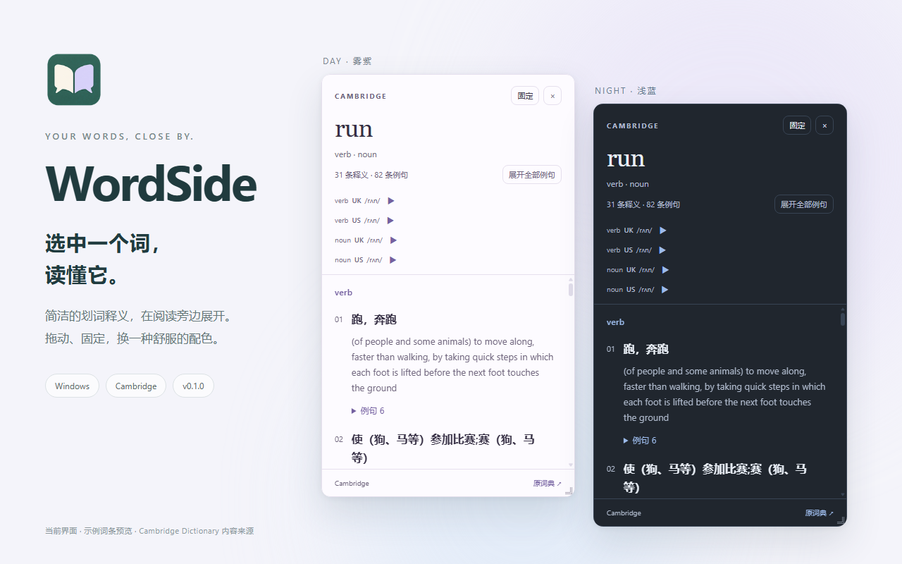

<p align="center">
  
</p>
<h1 align="center">WordSide</h1>
<p align="center">选中一个词，读懂它。<br>一个安静、紧凑的 Windows 划词词典。</p>
<p align="center"><strong>0.1.0 · Windows x64 · Tauri + Rust · Cambridge Dictionary</strong></p>
<p align="center">
  <a href="https://github.com/caoshuo2003/wordside/releases/tag/v0.1.0">下载首版</a> ·
  <a href="docs/USER-GUIDE.md">使用指南</a> ·
  <a href="docs/FAQ.md">常见问题</a> ·
  <a href="docs/DEVELOPMENT.md">参与开发</a> ·
  <a href="docs/ATTRIBUTION.md">项目来源</a>
</p>



*截图为当前界面的隔离预览，使用示例词条；不包含真实桌面或私人选词。*

## 让查词留在阅读旁边

在终端、网页或文本区域遇到陌生英文时，选中单词，WordSide 会在小浮窗里展示释义、例句、音标和发音。想自己决定何时查词，也可以关闭自动划词，只用快捷键。

| 你想做什么 | WordSide 提供什么 |
|---|---|
| 少打断阅读 | 自动划词、独立快捷键、手动输入三种入口 |
| 看清词义 | 英汉优先；明确缺词后尝试英英，保留已有英文内容 |
| 修正不完整选词 | 清理边缘符号；未找到词条时展示 Cambridge 提供的拼写建议 |
| 让浮窗待在合适的位置 | 拖动、自由缩放、记住尺寸；固定后在同一窗口更新新词 |
| 调整阅读氛围 | 薄荷绿、雾紫、浅蓝、暖灰；日间、夜间、跟随系统 |
| 随时开关 | 自动划词独立开关；关闭主窗口可选择驻留托盘或退出 |

自动取词取决于源应用提供的选区能力，不能保证所有 Windows 软件都支持。Linux / CLI / tmux 和 AI 翻译尚不属于此桌面版。

## 三步开始

1. 从 [v0.1.0 Release](https://github.com/caoshuo2003/wordside/releases/tag/v0.1.0) 下载安装包，或解压便携包运行。
2. 打开 WordSide，选择自动划词开关、快捷键与喜欢的配色。
3. 在其他应用选中英文单词，开启自动划词后等待释义，或按默认 **Ctrl+Alt+A** 主动查询。

需要 Windows x64、Microsoft Edge WebView2 和能访问 Cambridge 的网络。发布包内置 Rust 查词，无需安装 Node、部署 API 或填写第三方服务地址。

| 下载文件 | 适合谁 |
|---|---|
| `WordSide_0.1.0_x64-setup.exe` | 希望正常安装、创建快捷方式的用户 |
| `WordSide_0.1.0-portable.zip` | 希望解压即用，程序、许可和说明一起保存的用户 |
| `WordSide_0.1.0.exe` | 单独运行主程序；第三方许可可从同一 Release 下载 |

[完整教程 →](docs/USER-GUIDE.md) · [网络与取词问题 →](docs/FAQ.md) · [本版说明与验证范围 →](docs/releases/v0.1.0.md)

## 一点设计取舍

- **内容先完整，再显示。** 读取网页并检查词条结构后一次返回；保留原解析器覆盖的释义、译文、核心例句和发音，不冒称完整复刻网页所有栏目。
- **不替你猜单词。** `“runtime,”` 会清理边缘标点，词内连字符和撇号保留；多选或少选字母时，只展示词典的候选，由你点击确认。
- **提示面向读者。** 缺中文时保留英文，使用轻量标记；网络错误不伪装成词典缺词，也不把底层 API 异常直接放到界面。
- **只保留必要状态。** 设置保存到本机；词条只在内存短期缓存，退出清空。无常驻 API 服务器，也不携带 Node 运行时。

## 参考项目与致谢

**WordSide 的 Cambridge 解析实现基于 [Nongfsq/cambridge-dictionary-api](https://github.com/Nongfsq/cambridge-dictionary-api) 修改与移植。** 该项目继承自 [chenelias/cambridge-dictionary-api](https://github.com/chenelias/cambridge-dictionary-api)，原许可证保留 **EliasChen** 署名。感谢原项目提供清晰的字段结构与网页解析实现。

仓库保留 JS 改版、原始解析器测试对照和 MIT 许可；桌面将该解析行为移植到 Rust，增加选词、窗口交互、连接复用、完整性校验与错误处理。它不是 Cambridge 官方客户端，也不依赖他人部署的 API。

详见 [来源与改动](docs/ATTRIBUTION.md)、[上游记录](modules/cambridge-dictionary-api/UPSTREAM.md)、[原 MIT 许可证](modules/cambridge-dictionary-api/LICENSE.txt)和 [NOTICE](NOTICE.md)。WordSide 自有代码尚未采用对外开源许可，第三方代码仍遵循各自许可。

## 开发与维护

```sh
git clone https://github.com/caoshuo2003/wordside.git
cd wordside
npm ci
npm exec --yes --package=pnpm@9.15.9 -- pnpm --dir modules/cambridge-dictionary-api install --frozen-lockfile
npm test
npm run check
npm run build
```

私有仓库需有访问权限。Node 版本见 `.node-version`，仅用于开发；Windows 原生构建还需要 Rust、MSVC 和 Windows SDK，见[开发说明](docs/DEVELOPMENT.md)。

```text
desktop/                       设置、释义界面与 Tauri/Rust 桌面端
modules/cambridge-dictionary-api/  Nongfsq 改版与原解析器对照
shared/                        数据校验与共享选词规则
tools/                         软件构建、许可与验证工具
third-party/                   原生依赖许可补充
docs/                          教程、架构、来源、发布与界面素材
.github/                       项目 CI、Issue / PR 模板
```

`main` 保存可发布代码，后续工作使用短期分支与 PR；首次 GitHub 基线为 **v0.1.0**。参见[维护约定](CONTRIBUTING.md)、[路线图](docs/ROADMAP.md)、[变更记录](CHANGELOG.md)。
