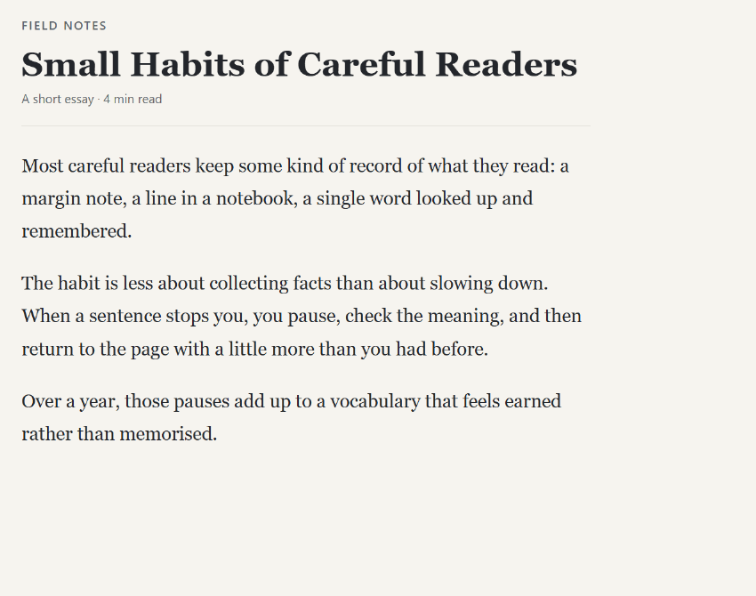
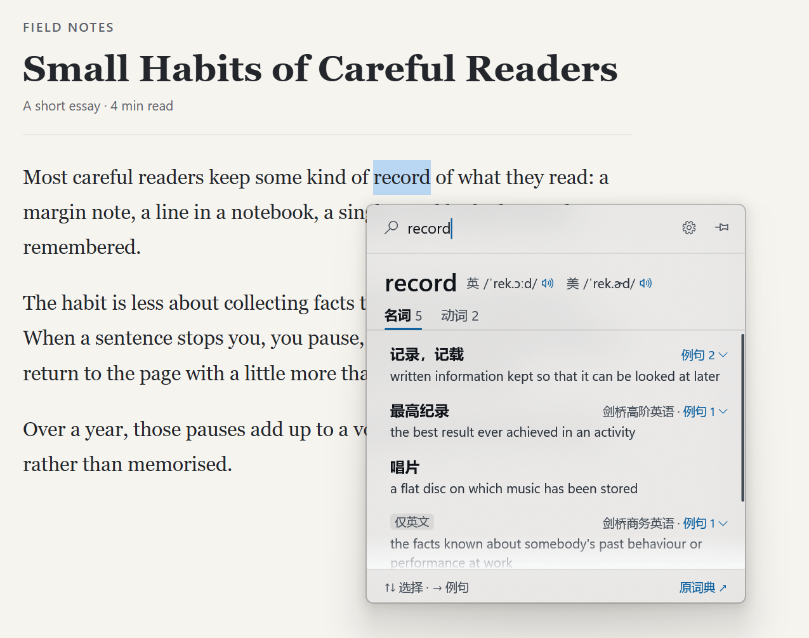
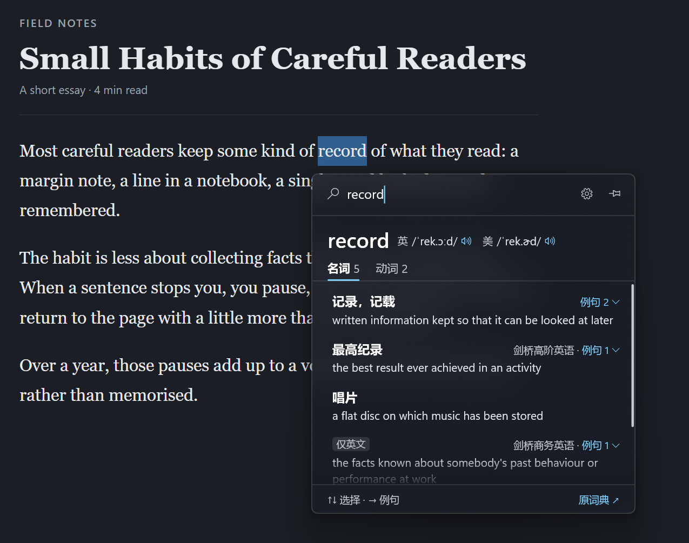

  

<h1 align="center">WordSide · 词伴</h1>

选中一个词，看一眼释义，接着读。 极简的 Windows 划词词典。

<strong>Windows x64 · Cambridge Dictionary</strong>

  <a href="https://github.com/caoshuo2003/wordside/releases/latest">下载</a> ·
  <a href="docs/USER-GUIDE.md">使用指南</a> ·
  <a href="docs/FAQ.md">常见问题</a> ·
  <a href="docs/PRIVACY.md">隐私与数据</a>

  

WordSide 只做一件事：**查词**。在任何应用里选中一个英文单词或短语，旁边就出现一张小卡片，上面是 Cambridge Dictionary 的中文释义、英文解释、音标和发音。看完点别处，卡片就收起，焦点一直留在你正在读的地方。

没有主窗口，没有生词本，不记查询记录，也不做整句翻译。它平时只在托盘里待命，是一个不需要 WebView2 的原生小程序。

## 开始使用

从[发布页](https://github.com/caoshuo2003/wordside/releases/latest)下载安装版（推荐）或单个 exe，需要 Windows x64 和能访问 Cambridge 的网络。安装版只装给当前用户，不需要管理员权限。程序没有数字签名，Windows 可能提示“已保护你的电脑”，点“更多信息”→“仍要运行”。

| 怎么查 | 操作 |
|---|---|
| 选中就查 | 托盘右键勾选“自动划词”，然后双击或拖选英文单词 |
| 快捷键 | 选中单词后按 **Ctrl+Alt+A**，可在卡片的设置里修改 |
| 手动输入 | 左键点托盘图标，输入单词后按 Enter |

## 卡片上有什么

<table>
  <tr>
    <td></td>
    <td></td>
  </tr>
  <tr>
    <td align="center">浅色</td>
    <td align="center">深色</td>
  </tr>
</table>

*真实截图，词条为示例数据。[图片说明](docs/SCREENSHOTS.md)*

- **释义**：中文在前，英文解释在后；按词性分组，例句点开才显示。
- **发音**：英式、美式音标，点喇叭直接播放。
- **选词不用太准**：多选到的标点、符号、旁边的中文、脚注编号会自动去掉；查不到时给出拼写建议。
- **键盘就够用**：↑↓ 选择释义，→ 展开例句，Tab 切换词性，Esc 收起。
- **不打扰**：不抢原窗口的焦点，点外面就收起；需要时用图钉固定。浅色、深色或跟随系统。

读不到选区的应用里，可以在卡片里手动输入。更多用法见[使用指南](docs/USER-GUIDE.md)，取词限制和网络问题见[常见问题](docs/FAQ.md)。

## 隐私

查询的单词会发送给 Cambridge 来取得词条；设置保存在本机，词条只在内存里短暂缓存，退出即清空，不保存任何查询记录。详见[隐私与本地数据](docs/PRIVACY.md)。

## 致谢

**Cambridge 解析实现基于 [Nongfsq/cambridge-dictionary-api](https://github.com/Nongfsq/cambridge-dictionary-api) 修改与移植。** 该项目继承自 [chenelias/cambridge-dictionary-api](https://github.com/chenelias/cambridge-dictionary-api)，保留原作者 **EliasChen** 的署名与 MIT 许可。

词典内容来自 [Cambridge Dictionary](https://dictionary.cambridge.org/)。WordSide 是独立项目，与 Cambridge 没有官方关联。自有代码的开源许可尚未选定，第三方组件遵循各自许可，详见[项目来源](docs/ATTRIBUTION.md)与[许可声明](NOTICE.md)。

## 反馈

遇到问题，先在托盘右键选择“退出”再重新打开。仍能复现的话，欢迎[提交 Issue](https://github.com/caoshuo2003/wordside/issues)，写明 WordSide 版本、所在的应用和操作步骤；截图请遮住私人信息。

[开发指南](docs/DEVELOPMENT.md) · [贡献约定](CONTRIBUTING.md) · [路线图](docs/ROADMAP.md) · [更新记录](CHANGELOG.md)
