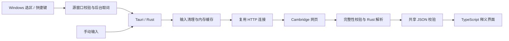

# 架构与边界

## 为什么保留 JS 模块

Cambridge 解析基于 Nongfsq 项目。`modules/cambridge-dictionary-api/` 保留其本机改版、原始解析器和 MIT 来源，用作 Rust 移植的行为对照；它可独立运行，但桌面不会启动 JS 服务，也不打包 Node。

## 模块职责

| 位置 | 责任 |
|---|---|
| `desktop/src-tauri/src/capture/` | Windows 选区、快捷键、源窗口与读取隔离 |
| `dictionary.rs`、`dictionary/http.rs` | 惰性连接池、并发限制、超时、取消和退出 |
| `dictionary/parser.rs` | Nongfsq 解析移植、词条完整性与候选校验 |
| `shared/dictionary.ts` | JSON 解码、输入清理和稳定错误类别 |
| `desktop/src/presentation.ts` | 面向用户的提示，不直接渲染原始诊断 |
| `desktop/src/app.ts` | 词条/例句/候选、查询序列与过期结果隔离 |
| `desktop/src/native.ts` | 设置同步、选词事件、浮窗拖动/缩放 |
| `popup_geometry.rs` | 逻辑尺寸偏好、布局/DPI 事件处理与合并保存 |
| `window_lifecycle.rs` | 主窗口关闭方式、释义关闭与托盘双击策略 |

## 关键规则

1. 自动划词与主动快捷键独立；固定窗口不暂停新词查询。
2. 只将明确缺词视为缺词；网络、超时、阻拦、残缺内容分别处理。
3. 英汉明确缺词才尝试英英；最终缺词时展示候选，点击才查询。
4. 完整结果校验后才缓存，词条仅在内存；取消/旧请求不能覆盖新词。
5. 设置按内存版本同步，旧响应不覆盖新选择；保存失败恢复已确认值。
6. Windows 取词留在平台适配层；未来其他平台使用独立实现。

## 当前范围

发布目标是 Windows x64 桌面词典。AI、词形模块、Linux 和服务器端均不在当前产品里。没有独立的常驻本机 HTTP 服务。
