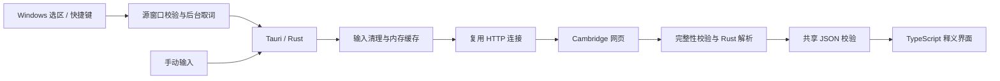

# 架构与边界

## 为什么保留 JS 模块

Cambridge 解析基于 Nongfsq 项目。`modules/cambridge-dictionary-api/` 保留其本机改版、原始解析器和 MIT 来源，用作 Rust 移植的行为对照；它可独立运行，但桌面不会启动 JS 服务，也不打包 Node。

## 模块职责

| 位置 | 责任 |
|---|---|
| `desktop/src-tauri/src/capture/` | Windows 选区、快捷键、源窗口与读取隔离、复制校对 |
| `dictionary.rs`、`dictionary/http.rs` | 惰性连接池、并发限制、超时、取消和退出 |
| `dictionary/parser.rs` | Nongfsq 解析移植、词条完整性与候选校验 |
| `shared/dictionary.ts` | JSON 解码、输入清理和稳定错误类别 |
| `desktop/src/presentation.ts` | 面向用户的提示，不直接渲染原始诊断 |
| `desktop/src/app.ts` | 词条/例句/候选、查询序列与过期结果隔离 |
| `desktop/src/native.ts` | 设置同步、选词事件、浮窗拖动/缩放 |
| `popup_geometry.rs` | 逻辑尺寸偏好、布局/DPI 事件处理与合并保存 |
| `window_lifecycle.rs` | 主窗口关闭方式、释义关闭与托盘双击策略 |

输入清理由 Rust `selection_input.rs` 和前端共享模块执行，使用同一份 JSON 样例校验。自动取词、快捷键、剪贴板兼容记录与手动查询都清理首尾标点及连字符；仅将词内 U+2010/U+2011 转为 ASCII 连字符，保留词内撇号。内嵌路径分隔符、换行及控制字符仍拒绝，不从无效内容中猜取一个子词。

## 关键规则

1. 自动划词与主动快捷键独立；固定窗口不暂停新词查询。
2. 只将明确缺词视为缺词；网络、超时、阻拦、残缺内容分别处理。
3. 英汉明确缺词才尝试英英；最终缺词时展示候选，点击才查询。
4. 完整结果校验后才缓存，词条仅在内存；取消/旧请求不能覆盖新词。
5. 设置按内存版本同步，旧响应不覆盖新选择；保存失败恢复已确认值。
6. Windows 取词留在平台适配层；未来其他平台使用独立实现。

## 通用选词校对

自动划词与快捷键共用同一读取链。先在原窗口与焦点检查下读取标准 Edit / Unicode RichEdit 的准确原生范围，成功则跳过复制；其余由 UIA 识别源窗口、选区和保护状态，再通过标准 Ctrl+Insert 复制核对，不按应用名称分支。原生控件的明确空选区、UIA 编辑器的空范围与受保护区域不会触发复制。只读文档的 UIA 空范围在明确 `VT_BOOL IsReadOnly=true` 时记为 `Unreported`，通过复制进一步核验；mixed、unsupported 或可编辑范围不会获得此项授权。

- `copy_policy.rs` 负责事务顺序、输入失效、序号归属和取消后清理；纯测试使用同一生产事务。
- `windows_copy.rs` 负责原生格式备份、源窗口与所有权检查、带标记输入和文本读取。自有备份有 64 MiB / 128 格式限制，全部成功后才复制。OLE 源取数可能在返回前分配内存，此预算不代表源进程峰值的硬限制。
- `windows_ole.rs` 在短暂 STA 中枚举并物化 OLE 对象的实际数据；每项立即独立复制，释放全部接口后再等待下一条请求。仅接受可用 Win32 静态格式表达的内容，非默认索引、目标设备、仅流/存储媒介或同 ID 冲突会在复制前失败。例外是复制的磁盘文件：剪贴板同时提供 `CF_HDROP` 路径列表时，资源管理器为同一批文件附带的 `FileGroupDescriptor(W)` + `FileContents` 虚拟文件视图不备份，恢复后保留路径等其余格式；没有路径的虚拟文件（压缩包、手机、邮件附件）仍在复制前失败。
- OLE 的 `DataObject` / `Ole Private Data` 不作为原进程句柄重放；只有原对象未将它们声明为实际数据、且所有声明成功物化后才排除传输元信息。恢复在原锁内写入实际静态格式，Windows 提供新的默认 OLE 包装器；不保留原对象身份、特殊媒介描述或虚拟文件行为。
- `timing.rs` 用物理输入边缘和 40ms 稳定释放门统一调度。已注册快捷键在低级键盘钩子的真实按下边沿记录原窗口、PID和控件，松键后仅等待原焦点恢复，等待限为 750ms，不改绑其他输入框；提交后仍严格核验焦点；仅同窗子焦点变化时，手动请求转换为来源绑定的失败卡，保留 serial、epoch、generation 和释放门，不采用旧词；取消决定及反馈使用同一份最新来源快照。新的独立快捷键可以替换未完成请求；结果和失败提示到主线程显示前再核对释放标记，推迟的显示保留候选。
- 延迟渲染使备份序号变化时，整次快照析构后最多重启两次，不拼接不同时间的数据；标准文本按终止符核对，保留原生完整分配，未知格式仍严格比较。
- 被动读取和内部备份/复制/恢复在同一 Worker 串行执行。协调线程不调用 `GetClipboardData`；被动读取使用可回收 helper，单次至多 200ms，且不超过原 350ms 选词授权期限。过期队列任务不再发送；返回仍核对 token、来源、输入代际和材料化后的最新序号。
- 输入 hook 线程处理只读释放状态修复：残留 held 状态在物理 all-up 连续采样 80ms 后清除，再重新经过 40ms 稳定门；键盘与鼠标边缘都会重置恢复计时，不模拟松键。
- `diagnostics.rs` 只覆盖保存最近一次失败的阶段、稳定错误代码和复制状态，文件限 4 KiB；不序列化 `Selection`、请求、单词、应用身份或剪贴板数据，成功查询不写记录。恢复协议区分已恢复、因序号/来源无法确认而安全跳过、失败；跳过不会记录为恢复完成。
- `probe.rs` 使用独立辅助进程持有备份，另一个进程读取 UIA / 复制文字；阻塞读取可回收，保留备份进程继续恢复。复制前的暂时读取失败可以在原来源、焦点和输入代数不变时等待 80ms 完整重读一次；任何部分或完整复制之后都不允许重试复制。辅助进程空闲 5 秒后退出。
- Alt 且不含 Ctrl 的已注册快捷键在真实按下边沿发送带本程序标记的无字符菜单保护键对，避免松 Alt 激活源应用菜单；自有注入不改变物理按键状态或选区代数。部分发送失败会在监听线程上尝试补释放。
- 文本读取在同一剪贴板锁内取得最终序号，允许延迟生成内容；恢复再次检查所有权与序号，新复制的数据优先。取消仅停止发布，复制后的读取和恢复使用独立的有限清理等待。若在首次序号归因前取消，或读取硬超时使最终物化序号不可知，会保守跳过恢复，可能留下临时内容，不放宽来源与序号保护。

不把旧剪贴板、未校对的 UIA 文本或超时当作成功。无法静态保存的 OLE 对象、超过期限才响应复制、读取硬超时以及剪贴板历史属于明确限制；真实 PDF、焦点与第三方应用兼容性需要桌面验证。

## 当前范围

当前发布目标为 Windows x64 桌面词典，查询由应用内的 Rust 模块执行。后续工作见[路线图](ROADMAP.md)。
