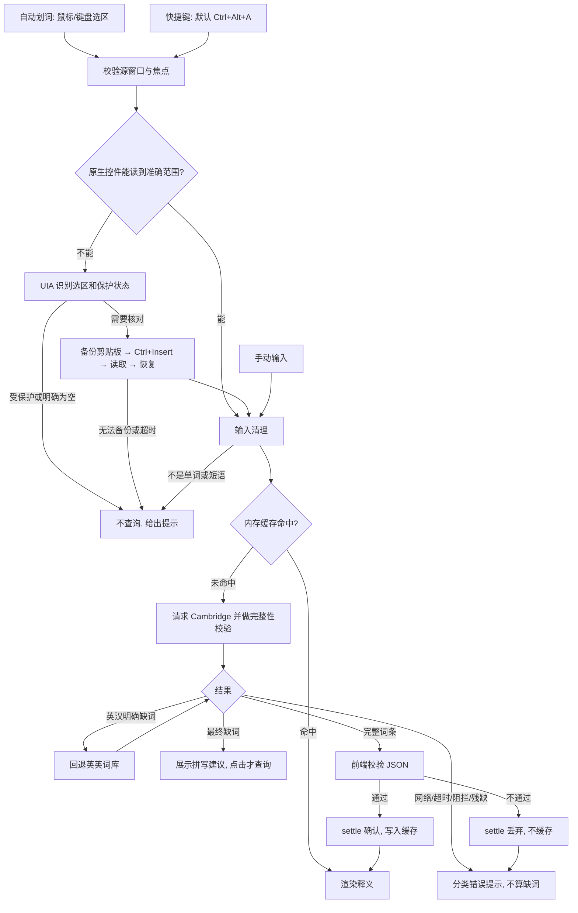

# WordSide 产品开发文档

| 项目 | 内容 |
|---|---|
| 基线 | `v0.2.0`（提交 `9da0577`） |
| 目标版本 | `0.3.0`：工程整理加 7.2 节的产品改进 |
| 状态 | 草案，里程碑开始前可调整 |
| 相关文档 | [架构](ARCHITECTURE.md) · [开发指南](DEVELOPMENT.md) · [贡献约定](../CONTRIBUTING.md) · [发布流程](RELEASING.md) |

**本文的三个前提：**

1. 目标是让产品更好更完善，不是单纯重写代码。核心工作流（第 2 节）和开发工作流（第 8 节）保持不变。
2. 渐进式改进，继续使用 Tauri 2 + Rust + TypeScript，不重写，也不换技术栈。
3. 工程整理和产品改进分开提交：`refactor:` 不改行为，改进走 `feat:` 或 `fix:`。优先做 7.2 节的改进；路线图里的代理设置、Linux 等排到 0.3.0 之后。

---

## 1. 产品定义

**定位：** 一款安静、紧凑的 Windows 划词词典。选中一个英文词，就能在阅读旁看到 Cambridge Dictionary 的释义、音标、例句和发音。

| 项目 | 范围 |
|---|---|
| 目标用户 | 在 Windows 上阅读英文网页、PDF、终端内容的中文使用者 |
| 平台 | Windows x64，依赖 WebView2 |
| 分发方式 | NSIS 安装包、便携 ZIP、单独 EXE，均通过 GitHub Release |
| 明确不做 | 账号、云同步、查词历史、AI 翻译（仅探索）、其他平台的自动取词 |

## 2. 产品工作流（重构后必须保持）



**不可破坏的规则**（来自 [ARCHITECTURE.md](ARCHITECTURE.md) 和代码）：

1. 自动划词与快捷键相互独立；关闭自动划词后快捷键仍可用；固定窗口不暂停新词查询。
2. 只有明确缺词才算缺词，网络、超时、阻拦、残缺内容各自处理。
3. 取消的或过期的请求不能覆盖新词的结果。
4. 词条只有通过前端校验才进入缓存，且只放在内存。
5. 不把旧剪贴板、未校对的 UIA 文本或超时当作成功；用户期间新复制的内容优先于恢复。
6. 不从路径、日志、命令里猜一个子词。

## 3. 功能需求

| 编号 | 需求 | 验收标准 |
|---|---|---|
| FR-01 | 自动划词 | 开关打开后，在支持的应用选词即弹出浮窗；默认关闭 |
| FR-02 | 全局快捷键 | 默认 Ctrl+Alt+A；可修改、撤销、停用；保存与注册是一个事务 |
| FR-03 | 手动查词 | 输入词或短语后按 Enter 查询 |
| FR-04 | 输入清理 | 清理首尾符号；保留词内撇号和连字符；上限 80 字符、5 个词；由 `selection-cases.json` 约束 |
| FR-05 | 词条展示 | 中文释义在前；词性标签带条数并可跳转；英/美发音，读音相同时合并；例句可展开；“原词典”链接 |
| FR-06 | 缺词处理 | 英汉缺词回退英英；最终缺词显示拼写建议（最多 10 条），点击才查询 |
| FR-07 | 浮窗 | 可拖动、四边四角缩放；尺寸跨重启保留；固定后同窗更新；重启后恢复未固定 |
| FR-08 | 外观 | 4 套配色 × 浅色/深色/跟随系统；托盘和窗口图标随配色变化 |
| FR-09 | 托盘与关闭 | 关闭主窗口可选隐藏到托盘或退出；双击托盘打开；右键菜单切换/打开/退出；单实例 |
| FR-10 | 诊断 | `capture-status.json` 记录最近一次故障；CLI 入口 `--wordside-dictionary-probe` / `-parse` / `-licenses` |

## 4. 非功能需求

重构时以下数值和约束不能变；要改须写 ADR。

| 类别 | 约束 | 来源 |
|---|---|---|
| 隐私 | 查询词只发往 Cambridge；词条不落盘；诊断文件不超过 4 KiB，且不含单词、应用身份、剪贴板内容 | [PRIVACY.md](PRIVACY.md)、`capture/diagnostics.rs` |
| 缓存 | TTL 15 分钟、最多 32 条、总量 12 MiB | `cache.rs:3-4,18` |
| 剪贴板 | 备份上限 64 MiB / 128 种格式；被动读取单次不超过 200 ms | ARCHITECTURE |
| 时序 | 40 ms 稳定释放门；750 ms 焦点等待上限；复制前重读等待 80 ms；残留按键状态 80 ms 后清除 | ARCHITECTURE、`capture/timing.rs` |
| 安全 | CSP 不放宽；`open_source` 只允许 `https://dictionary.cambridge.org` | `tauri.conf.json:41`、`main.rs:159-163` |
| 兼容 | 旧 `settings.json` 能读，未知或废弃字段不影响其他偏好 | `main.rs:24-30`、`settings_tests` |
| 兼容 | 不改应用标识 `local.wordside.dictionary.api-preview`：它决定设置目录，改了会丢失用户设置 | `tauri.conf.json:5`、PRIVACY |
| 发布 | 主程序体积约 11.9 MB，增长超过 10% 须说明原因 | CHANGELOG 0.2.0 |
| 授权 | 保留 Nongfsq / EliasChen 署名和 MIT 许可 | [NOTICE](../NOTICE.md) |

## 5. 现状分析

### 5.1 技术栈与代码分布

| 区域 | 位置 | 规模 | 说明 |
|---|---|---|---|
| 取词 | `desktop/src-tauri/src/capture/` | 约 327 KB | Win32、UIA、OLE、剪贴板事务，占 Rust 代码约 78% |
| 词典 | `src/dictionary/` | 约 33 KB | reqwest + dom_query，解析逻辑移植自 JS |
| 应用层 | `main.rs` 和其余模块 | 约 58 KB，其中 `main.rs` 占 29 KB | 设置、窗口、托盘、缓存 |
| 界面 | `desktop/src/`、`shared/` | 约 54 KB TS，25 KB CSS | 无框架，`tsc` 用 `outFile` 合并 |
| 对照模块 | `modules/cambridge-dictionary-api/` | 约 58 KB JS | 不进发布包，只用来校对 Rust 解析行为 |

**测试：** Rust 测试二进制 226 个用例，`npm test` 66 个。

### 5.2 前后端接口（重构时冻结）

- **命令（13 个，`main.rs:213`）：** `get_settings`、`set_enabled`、`save_appearance`、`save_close_behavior`、`save_lookup_hotkey`、`cancel_lookup`、`popup_ready`、`set_pinned`、`set_window_frame`、`hide_popup`、`open_source`、`lookup`、`settle_lookup`
- **事件（`native.ts:138-150`）：** `native-state`、`native-hidden`、`native-capture-started`、`native-selection`、`native-selection-failed`、`native-capture-feedback`

### 5.3 值得保留的设计

- `copy_policy.rs` 的 `Backend` trait：把剪贴板事务抽成可测试的纯逻辑，生产和测试走同一段代码。其他平台相关逻辑应向它看齐。
- `shared/tests/selection-cases.json`：Rust 和 TS 共用一份输入清理用例。
- 缓存的 ticket / settle 协议：过期结果无法改动较新的缓存。
- 用合成夹具对照上游解析器，不把真实网页放进仓库。
- 原子写设置文件，以及诊断文件的隐私边界。

### 5.4 问题清单

| 编号 | 优先级 | 问题 | 证据 | 处理里程碑 |
|---|---|---|---|---|
| P-01 | 高 | `main.rs` 同时承担设置模型、持久化、全部命令、查询编排、托盘、窗口事件和 CLI 诊断 | `main.rs:18-64,167-191,207-274,346-383` | M3 |
| P-02 | 高 | 取词测试没有安全的默认入口：默认跳过 `capture::`，要靠 16 个过滤器逐个运行；宽泛的 `capture::` 过滤器还会碰到操作窗口的实机夹具。此外有 9 个用例不在任何过滤器内，CI 从未运行，其中 5 个没有标记 `#[ignore]`，看不出是被有意跳过 | `windows-cargo.ps1:71`、`ci.yml:62-79`、DEVELOPMENT | M1 |
| P-03 | 高 | 过滤器清单写了两份并已漂移：DEVELOPMENT 缺 `windows_edit`、`dismissal` | `ci.yml:77-78` 对比 `DEVELOPMENT.md:62-77` | M1 |
| P-04 | 高 | 没有格式和 lint 门禁，存在超长行：`probe.rs` 最长 794 字符，`main.rs` 最长 633 字符，且有 14 行超过 200 字符 | `main.rs:219`；CI 无 fmt / clippy 步骤 | M1 |
| P-05 | 高 | `windows.rs`（828 行）、`windows_copy.rs`（982 行）、`probe.rs`（545 行）把决策逻辑和 `unsafe` Win32 调用混在一起，只能靠实机验证 | `unsafe` 集中在 `windows_copy.rs`（58 处匹配）、`windows.rs`（25 处匹配） | M5 |
| P-06 | 中 | “克隆 → 持久化 → 赋值 → 增加 revision → 广播”的设置更新流程重复 4 次 | `main.rs:95,112,120,132` | M3 |
| P-07 | 中 | `State` 集中了 5 个计数器（`lookup_serial`、`main_epoch`、`popup_epoch`、`capture_epoch`、`capture_serial`），它们的递增散落各处，取消语义难以追踪 | `main.rs:40,97-98,134,152,172,264` | M3 |
| P-08 | 中 | 查询取消靠每 30 ms 轮询一次 | `main.rs:189` | M4 |
| P-09 | 中 | 查询结果在后端一直以 `serde_json::Value` 传递，模型靠人工与 `shared/dictionary.ts` 保持一致 | `main.rs:167`、`cache.rs:5`、`dictionary.ts:3-7` | M4 |
| P-10 | 中 | 前端是全局脚本（`module: none` + `outFile`），`app.ts` 顶层有副作用；测试要转译源码、放进 `vm`，再手写假 DOM | `tsconfig.json:4,12`、`app.ts:7-62`、`native-startup.test.cjs:5-30` | M6 |
| P-11 | 中 | 前端用 localStorage 保存一份设置，且 `enabled` 默认值（`true`）与后端（`false`）不同，要等原生设置同步后才修正 | `app.ts:62`、`main.rs:22`、`native.ts:37` | M6 |
| P-12 | 中 | 应用版本号散落在 6 个配置和锁文件里靠手工更新（还不算 README 和文档），发布也全部手工完成；CI 不响应标签 | `RELEASING.md:9-11`、`ci.yml:3-8` | M1、M7 |
| P-13 | 中 | CI 单次约 22 分钟：测试用 `--release`（thin LTO、`codegen-units=1`），且没有 Cargo 缓存 | 运行记录 `39291291018`、`Cargo.toml:25-29`、`ci.yml` | M1 |
| P-14 | 低 | 文档漂移：ROADMAP 仍写基线 0.1.0；PR 模板要求链接 ADR，但仓库没有 ADR 目录 | `ROADMAP.md:3`、`pull_request_template.md:17` | M1 |
| P-15 | 低 | `main` 没有分支保护（API 返回 404），历史上有未走 PR 的直接提交（如 `ce20a4c`） | `gh api …/branches/main/protection` | M1 |

## 6. 目标架构

**原则：** 决策和副作用分离，一次只动一层，接口冻结，每个里程碑结束时 `main` 都可发布。

```text
desktop/src-tauri/src/
├─ main.rs                入口：只分派诊断模式和桌面模式
├─ app/                   state、commands（薄层）、tray、window_events、setup
├─ settings/              model（含旧字段迁移）、store（统一的更新事务，解决 P-06）
├─ lookup/                service（缓存门控、回退、取消）、cache、selection_input、diagnostics_cli
├─ dictionary/            结构保持不变，只增加类型化的输出
├─ window/                popup_geometry、window_frame、palette_icon、lifecycle、dismissal
└─ capture/
   ├─ core/               无 Win32 依赖的纯逻辑：policy、timing、copy_policy、selection、shortcut、compatibility
   └─ windows/            hook、UIA、Edit、OLE、clipboard、probe：只做系统调用，通过 trait 接入 core

desktop/src/              ES 模块：main、settings-view、entry-view、lookup-controller、popup-window、presentation、native-api
shared/dictionary.ts      改成带 export 的模块，继续作为 JSON 校验层
```

**已定的技术选择：**

| 问题 | 决定 | 理由 |
|---|---|---|
| 前端是否引入框架或打包器 | 不引入，用 `tsc` 输出 ES 模块，用 `<script type="module">` 加载 | 代码量小；CSP `script-src 'self'` 无需改动；不增加依赖 |
| 取消机制 | `tokio::sync::watch`，保留“世代”语义 | 去掉轮询，取消时立即唤醒 |
| 实机测试如何隔离 | 改用 `#[ignore]`，另设显式命令运行 | `cargo test` 默认就安全，不再需要过滤器清单 |
| 词条类型 | Rust 用类型化结构，序列化出的 JSON 与现在逐字节一致 | 用现有 `native-cambridge.json` 夹具保证 |

## 7. 开发里程碑

**总体策略：** 重点拆应用层，取词层尽量少动。产品已经可用；取词代码的稳定性是实机反复调出来的，自动测试覆盖不到这些行为，大改容易把修好的问题改回来。执行顺序为 M1 → M2 → M3 → M4 → M6；M5 不做整体拆分。

每个里程碑拆成多条短期分支，分别走 PR 合入 `main`，不设长期 `refactor` 分支。

| 里程碑 | 内容 | 建议分支 | 完成标准 |
|---|---|---|---|
| **M0 基线** | 本地跑通全部检查；按 7.1 实测一遍 0.2.0。实测记录不进仓库 | 无 | 自动检查已完成（见第 11 节）；实机场景在其他电脑上继续测 |
| **M1 工程护栏** | 一次性 `cargo fmt`（登记到 `.git-blame-ignore-revs`）；CI 加 fmt / clippy；实机测试改 `#[ignore]`；CI 改用 dev 配置并加缓存；版本一致性检查脚本；建 `docs/adr/`；修 ROADMAP；开分支保护 | `chore/rustfmt`、`chore/test-layers`、`chore/ci-speed`、`chore/version-check` | `cargo test` 不碰桌面且覆盖全部原有用例（数量不减）；CI 明显低于 22 分钟 |
| **M2 接口冻结** | 为 13 个命令和 6 个事件写契约测试（字段名和形状）；为 `Settings` 写 JSON 快照测试 | `test/ipc-contract` | 改动接口会让 CI 失败 |
| **M3 应用层拆分** | 拆 `main.rs` 到 `app/`、`settings/`、`window/`；提取 `SettingsStore::update`；把计数器收拢成有名字的类型 | `refactor/app-layer`、`refactor/settings-store`、`refactor/epochs` | `main.rs` 少于 50 行；设置更新只有一个入口；P-01、P-06、P-07 关闭 |
| **M4 查询链路** | 提取 `lookup::service`；`watch` 替换轮询；词条类型化 | `refactor/lookup-service`、`refactor/typed-entry` | 夹具 JSON 无差异；取消和过期测试全过；P-08、P-09 关闭 |
| **M5 取词层**（按需，不做整体拆分） | 只在修具体问题时，顺手按 `Backend` 模式抽出相关的纯逻辑；一次只动一个模块 | `fix/…`，必要时 `refactor/capture-<模块>` | 每个 PR 都附 7.1 中相关项的实测结果；P-05 不作为 0.3.0 的发布条件 |
| **M6 前端模块化** | 改 ES 模块；状态集中；以原生设置为唯一来源，localStorage 只用于浏览器预览；同步更新测试 | `refactor/ui-modules`、`refactor/ui-state` | 测试不再依赖 `vm` 拼接；P-10、P-11 关闭；截图对比无变化 |
| **M7 发布** | 打标签触发的发布工作流（构建、校验、SHA256、草稿 Release）；发 0.3.0 预发布版试用，再转正式版 | `chore/release-workflow`、`chore/release-0.3.0` | 7.1 实测完成，未测项写明原因，R-06、R-07 必测；从 0.2.0 升级后设置保留 |

**顺序依赖：** M1 → M2 → M3 → M4；M6 依赖 M2；M5 随修复进行；M7 最后。7.2 节的改进在 M1 之后穿插进行。

**M0 现状：** 自动检查已完成。浏览器、终端、PDF、托盘等场景需要人工测试，不阻塞后续开发，但要在 M7 发布前完成。

### 7.1 回归验收矩阵

这些项目都来自 CHANGELOG 里修过的真实问题，只能实机验证，不能用模拟代替。

| 编号 | 场景 | 预期 | 来源版本 |
|---|---|---|---|
| R-01 | 系统记事本、常见输入框选词 | 原生范围准确读取，不触发复制 | 0.1.2 |
| R-02 | Edge / Chrome 网页（如 GitHub）连续划词和快捷键 | 不误报“请重新选词” | 0.1.3、0.1.4 |
| R-03 | Zotero 等 PDF | 不读到相邻或偏移的文字 | 0.1.1 |
| R-04 | PowerShell 7 终端用 Alt+D | 选区不被清除，不激活菜单 | 0.1.2、0.1.3 |
| R-05 | Pebrel 终端 | 自动划词和快捷键都可用 | 0.1.4 |
| R-06 | 剪贴板里有资源管理器复制的文件时取词 | 可取词，之后仍能粘贴文件 | 0.2.0 |
| R-07 | 取词前后剪贴板内容（文本、位图、富文本） | 恢复；期间新复制的内容优先 | 0.1.1、0.1.2 |
| R-08 | 密码框和受保护区域 | 不读取、不复制 | 0.1.2 |
| R-09 | 长时间闲置、开机繁忙后 | 监听自动恢复，无需重启 | 0.1.4 |
| R-10 | 双击、拖选、关闭旧浮窗后再选 | 每次都触发，不重复启动 | 0.1.2、0.1.3 |
| R-11 | 查询 `minutes`、`runtime`、`term`、错拼词 | 短语词条有释义；错拼显示建议 | 0.1.3 |
| R-12 | 不同 DPI 和多显示器之间移动浮窗 | 尺寸和位置正确；图标清晰 | 0.1.0、0.2.0 |
| R-13 | 托盘：双击、右键、关闭到托盘后重建主窗口 | 符合 FR-09 | 0.1.0 |
| R-14 | 安装版、便携版；从 0.2.0 升级 | 正常运行，设置保留 | 0.1.0 |
| R-15 | 断网、取消查询、快速连续查词 | 分类提示；旧结果不覆盖新词 | 0.1.0 |

### 7.2 产品改进清单

来自 2026-11-02 对 0.2.0 的一次实测（记事本、LibreOffice，由工具模拟操作）。

| 编号 | 优先级 | 改进 | 依据 | 完成标准 | 建议分支 |
|---|---|---|---|---|---|
| I-01 | 高 | 浮窗不遮挡选中的单词，错误和空状态时缩小高度 | 选区下方放不下时，浮窗盖住了单词；空状态大半空白（`capture.rs:28-33`） | 屏幕各边缘选词都不盖住单词；空状态高度贴合内容；用户设定的尺寸仍保留 | `fix/popup-placement` |
| I-02 | 中 | 被拦截时说明原因，并给出下一步（如在浏览器打开原词典） | 被拦时只提示“稍后再试”，重试也没用 | 拦截和网络失败的提示不同 | `fix/blocked-message` |
| I-03 | 中 | 读取错误时回退到复制核对，先覆盖 LibreOffice，并确认不放宽密码框等保护 | LibreOffice 26.8 自动划词无反应，快捷键提示读不到文字，状态为 `read_error` | LibreOffice 能取词；受保护区域仍不读取；有回归测试 | `fix/capture-read-error` |
| I-04 | 中 | 验证最小化窗口能否恢复，需要时修复 | 只是代码疑点，未实测（`main.rs:193`） | 最小化后双击托盘和再次启动都能恢复主窗口 | `fix/restore-minimized` |
| I-05 | 中 | 处理 CI 从未运行的 9 个用例（P-02） | 用例清单对比 | 每个用例都有明确归属 | 并入 M1 的 `chore/test-layers` |
| I-06 | 低 | 代码签名，减少 Windows 安全警告 | exe 未签名，再次启动时弹出过安全警告 | 比较证书成本后决定 | `chore/code-signing` |
| I-07 | 待定 | 词典来源抽成接口，增加离线词库兜底 | 一个网络环境下，Cambridge 对所有请求要求人机验证（经代理也一样）；维护者在其他环境使用正常 | 先在其他电脑上确认影响范围，再决定是否做 | `feat/dictionary-source` |

**边界：** 不做任何绕过人机验证的手段，包括伪装浏览器指纹、自动完成验证、借用 WebView 的验证状态。如果要做离线词库，先确认授权和体积，首选 ECDICT；长期依赖 Cambridge 的正路是申请正式授权（见 NOTICE 中的授权页面）。

## 8. Git 版本管理

沿用 [CONTRIBUTING.md](../CONTRIBUTING.md) 和 [RELEASING.md](RELEASING.md)，只为重构补充必要的规则。

### 8.1 分支与提交

```text
main ─●───●───●────●── v0.3.0
       \ /   \ /
    chore/…  refactor/…     （短期分支，squash 合入，合并后删除）
```

| 工作 | 分支 | 提交前缀 |
|---|---|---|
| 行为不变的重构（本文新增） | `refactor/<范围>` | `refactor:` |
| 功能 / 修复 | `feat/…` / `fix/…` | `feat:` / `fix:` |
| 工程 / 文档 / 测试 | `chore/…` / `docs/…` / `test/…` | `chore:` / `docs:` / `test:` |
| 未确定的实验 | `exp/…` | 说明实验目的 |

### 8.2 重构专用规则

1. **移动和改动分开。** 移动文件或拆模块的提交不改逻辑，这样 diff 才审得动。
2. **格式化单独成提交**，并把哈希写入 `.git-blame-ignore-revs`，保住 `git blame`。
3. **发现 bug 不顺手修。** 开 `fix/` 分支单独处理，并写进 CHANGELOG。重构 PR 不应改变行为。
4. **测试数量不减。** PR 里写明前后的用例数；模块移动导致测试路径变化时，同步更新 CI。
5. **一个 PR 只动一个 capture 模块，** 并附实测结果。
6. **接口或依赖有较大变化时写 ADR**，放在 `docs/adr/NNNN-标题.md`。
7. **任务分支不强推**，`main` 只接受 `--ff-only` 同步，已有标签不移动。

### 8.3 版本号与标签

| 改动 | 版本 |
|---|---|
| 纯文档、纯内部里程碑（未发布） | 不变 |
| 发布前的回归修复 | `0.2.x` |
| 工程整理和 7.2 节改进完成 | `0.3.0`，先用 `--prerelease --latest=false` 试用，再转正式版 |

- `v0.2.0` 就是重构基线，不需要另打标签，随时可用 `git diff v0.2.0` 对比。
- 只打 annotated tag，从已通过 CI 的 `main` 创建。
- 成品放 GitHub Release，不进入 Git。

### 8.4 一次改动的完整流程

```sh
git switch main
git pull --ff-only
git switch -c refactor/settings-store
# 修改并运行受影响的检查
git add <具体文件>
git diff --cached
git commit -m "refactor: 提取设置更新事务"
git push -u origin refactor/settings-store
gh pr create --fill
# 等 CI 通过并检查 diff，然后 squash 合并
git switch main
git pull --ff-only
git diff refactor/settings-store main   # squash 后 Git 认不出已合并，先确认没有差异
git branch -D refactor/settings-store
```

### 8.5 分支保护（M1 启用）

`main`：必须通过 PR 合入；必须通过 `JavaScript and UI (Linux)` 和 `Windows native` 两项检查；禁止强推和删除。单人维护不要求第二位审查者，与 CONTRIBUTING 一致。

## 9. 风险

| 风险 | 影响 | 对策 |
|---|---|---|
| 取词时序因重构改变，自动测试发现不了 | 高 | M5 一次一个模块；保留时序常量；每个 PR 附实测 |
| 破坏剪贴板恢复，影响用户数据 | 高 | `copy_policy` 的事务测试不动；R-06、R-07 必测 |
| Cambridge 页面结构变化或访问策略调整 | 中 | 已在一个网络环境下被 Cloudflare 人机验证拦下，影响范围待确认（I-07）；用夹具把“解析回归”和“网站变化”分开 |
| 大范围格式化干扰 blame 和进行中的分支 | 中 | M1 最先做，趁当前没有进行中的分支；登记 ignore-revs |
| 单人项目的实机验证被跳过 | 中 | 分支保护管不到实测，靠 PR 模板如实填写，未测项明确写出 |

## 10. 待决事项

| 事项 | 现状 | 建议 |
|---|---|---|
| 自有代码的开源许可 | 仓库已公开，但未选许可（NOTICE），他人没有复用授权 | 由仓库所有者决定，0.3.0 前定下来 |
| 重构在哪个仓库进行 | 本文按原仓库 `caoshuo2003/wordside` 编写 | 如改用新仓库，第 8 节的流程不变，但需要重配 CI 和 Release |

## 11. 基线验证状态

| 检查 | 状态 |
|---|---|
| 远端 CI（`main` @ `9da0577`，运行 `39291291018`） | 通过，耗时 21 分 49 秒 |
| 本地 `npm test` / `npm run check` / `npm run build` | 通过，`npm test` 66 个 |
| 本地 `windows-cargo.ps1 -Action test` 及 16 个过滤器 | 226 个用例中，通过 215 个，跳过 2 个，9 个未运行（P-02） |
| 实机验收矩阵 7.1 | 部分完成，其余在其他电脑上继续测 |
