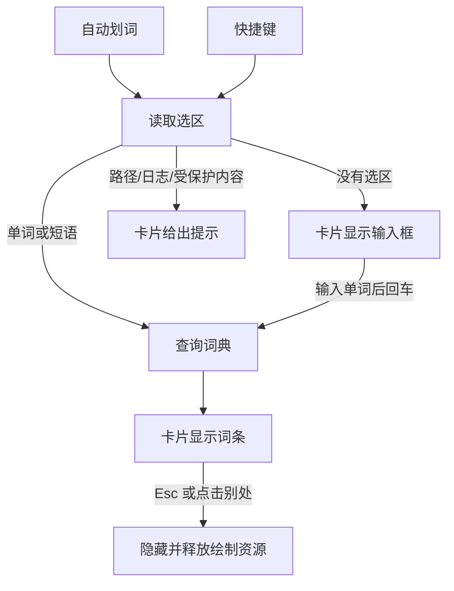

# WordSide 产品开发文档

| 项目 | 内容 |
|---|---|
| 基线 | `v0.2.0`（提交 `9da0577`） |
| 目标版本 | `0.3.0`：极简、极致轻量的原生版本 |
| 状态 | N2 代码完成，等预发布版在能访问 Cambridge 的电脑上实测后合并；第 9 节的两项待决事项不影响开工 |
| 相关文档 | [市场调研](MARKET-RESEARCH.md) · [架构](ARCHITECTURE.md) · [开发指南](DEVELOPMENT.md) · [贡献约定](../CONTRIBUTING.md) · [发布流程](RELEASING.md) |

## 1. 方向决定

维护者已确认以下决定，改动需要维护者同意。

| 问题 | 决定 |
|---|---|
| 产品定位 | 极简查词：极致轻量、美观，选中单词就能读懂 |
| 风格参考 | [frun](https://github.com/Nongfsq/frun)：一个面板、键盘优先、不用配置 |
| 视觉 | 拟态玻璃，约 55% 不透明度；不支持时自动退回不透明卡片 |
| 技术 | 纯 Rust + Direct2D + DirectWrite，**去掉 Tauri、WebView2、TypeScript** |
| 重构方式 | 新建结构后重写 |
| 必须保留 | 读取单词 API 的逻辑（请求 Cambridge 和解析词条） |
| 取词层 | 拆分结构，判断逻辑和时序规则保持不变 |
| 平台 | 只做 Windows x64 |

**不做：** 账号、云同步、查词历史、生词本、句子翻译、离线词库、独立主窗口、多套配色、macOS / Linux。

**定位的边界：** 轻量和美观靠品质取胜，不是“市场上没有”的功能，别人也能模仿。[语境词典](MARKET-RESEARCH.md#差异化方向)是以后可以叠加的方向，不进 0.3.0。

## 2. 产品设计

### 2.1 只有一张卡片



- 所有操作都在一张卡片里完成，没有独立的主窗口。
- 设置放在卡片内（`Ctrl + ,`），其余操作放右键菜单，和 frun 的做法一致。
- 卡片高度跟随内容，错误和空状态只占需要的高度。
- 卡片不遮挡选中的单词。
- 键盘优先：输入、回车、Esc、方向键和滚轮就够用。
- 正常启动只在托盘待命，不弹卡片；快捷键、托盘或再次启动才显示。

### 2.3 卡片的样子

N2 里和维护者逐项确认过，设计稿在 claude.ai 的“WordSide 0.3.0 卡片设计”画布。

| 部分 | 决定 |
|---|---|
| 尺寸 | 宽 400 px，最高 420 px；超出的释义在列表里滚动，底部渐隐提示还有内容 |
| 表头 | 单词后面同一行放读音，读音只显示当前词性的（切换词性标签时跟着换）；没有中文的词条才在表头提示 |
| 释义 | 第一行左边中文、右边来源和强调色的“例句 N”加箭头（表示能展开）；只有英文的释义前加“仅英文”；不编号 |
| 选中和悬停 | 没有竖线等固定标记。鼠标下的那条像通知一样弹起：上浮 3 px 略带回弹、玻璃底色变亮一档、顶部高光、柔和阴影；用键盘时选中的那条这样弹起 |
| 文字 | 英文优先 Segoe UI Variable Text，中文微软雅黑 UI；中文不小于 12.5 px；玻璃上的灰度文字提高对比度 |
| 读音按钮 | 轻量文字按钮（地区、音标、喇叭），悬停才有底色；播放时变强调色、失败时变灰并可重试 |
| 设置 | 卡片内一页：自动划词、查词快捷键（录制）、外观三项；底部版本和第三方许可 |
| 图标 | “弹出的卡片”：石墨底上一张白卡片从蓝色的词上弹出；托盘是同一造型的单色线稿，随任务栏深浅变色 |

### 2.2 功能需求

| 编号 | 需求 | 验收标准 |
|---|---|---|
| FR-01 | 自动划词 | 开关打开后，在支持的应用里选词即弹出卡片；默认关闭 |
| FR-02 | 全局快捷键 | 默认 Ctrl+Alt+A；可修改、停用；保存和注册是一个事务 |
| FR-03 | 手动查词 | 卡片内输入词或短语，回车查询；输入框只收英文，不经过输入法 |
| FR-04 | 输入清理 | 清理首尾符号；保留词内撇号和连字符；上限 80 字符、5 个词；由 `selection-cases.json` 约束 |
| FR-05 | 词条内容 | 释义、译文、例句、音标、词性跳转、“原词典”链接，字段和顺序不比 0.2.0 少 |
| FR-06 | 发音 | 点击或 Ctrl+P 播放英/美发音，读音相同时合并；只显示当前词性的读音，但每个读音都能通过词性标签找到 |
| FR-07 | 缺词处理 | 英汉缺词回退英英；最终缺词显示拼写建议（最多 10 条），选中才查询 |
| FR-08 | 卡片窗口 | 可拖动、调整宽度；尺寸跨重启保留；可固定，固定后同窗更新；不遮挡选中的单词 |
| FR-09 | 外观 | 玻璃卡片，浅色/深色/跟随系统；一个强调色；不内置字体；关闭系统透明效果或接口不可用时退回不透明，且可读性不下降 |
| FR-10 | 托盘 | 托盘图标；右键切换自动划词、打开设置、退出；单实例 |
| FR-11 | 错误提示 | 拦截、网络失败、超时、缺词的提示互不相同，并给出下一步 |
| FR-12 | 复制 | 右键复制当前单词或某条释义；不做任意拖选文字（见第 9 节 D-1） |
| FR-13 | 诊断 | 保留 `capture-status.json` 和 CLI 诊断入口 |

**相比 0.2.0 去掉的：** 主窗口、4 套配色和跟随变色的图标、关闭行为选项、四边缩放（只保留调整宽度，高度跟随内容）。

## 3. 非功能需求

### 3.1 性能预算

这是完整产品的目标。原型数字来自 2026-11-02 的原型（详见 `exp/native-card` 分支的 `experiments/native-card/README.md`）；N2 列是同日 `apps/wordside` 正式编译在开发机上的实测，还没有取词。

| 指标 | 0.2.0 实测 | 原型实测 | N2 实测 | **0.3.0 目标** |
|---|---|---|---|---|
| 程序大小 | 11.31 MB | 3.38 MB | 3.96 MB（含约 0.4 MB 第三方许可文本） | ≤ 5 MB |
| 进程数 | 8 | 1 | 1 | 1（取词辅助进程按需启动，空闲后退出） |
| 显示时私有内存 | 176.7 MB | 10.5 MB | 约 11.5 MB | ≤ 25 MB |
| 隐藏时工作集 | 未测 | 0.4 MB | 0.2 MB（启动后待在托盘）；查词并播放发音后 1.1 MB | ≤ 2 MB |
| 隐藏时私有内存 | 未测 | 8.5–10.4 MB | 2.7 MB（启动后）；查词并播放发音后 13.1 MB | ≤ 20 MB |
| 启动到首次绘制 | 未测 | 约 37 ms | 44–47 ms | ≤ 100 ms |
| 空闲 CPU | 未测 | 未测 | 0 | 接近 0；取词轮询不能破坏这一点 |

`tools/check-wordside.ps1` 在 CI 里检查大小，加 `-Runtime` 时再测托盘待命的内存和空闲 CPU；超出要说明原因。默认使用软件渲染，除非在其他机器上发现显示或速度问题。

### 3.2 必须保持的约束

| 类别 | 约束 |
|---|---|
| 隐私 | 查询词只发往 Cambridge；词条只在内存缓存；不保存查询记录；诊断文件不超过 4 KiB，且不含单词、应用身份、剪贴板内容 |
| 缓存 | TTL 15 分钟、最多 32 条、总量 12 MiB；只缓存通过校验的完整词条 |
| 剪贴板 | 备份上限 64 MiB / 128 种格式；被动读取单次不超过 200 ms；用户期间新复制的内容优先于恢复 |
| 时序 | 40 ms 稳定释放门；750 ms 焦点等待上限；复制前重读等待 80 ms；残留按键状态 80 ms 后清除 |
| 安全 | 打开外部链接只允许 `https://dictionary.cambridge.org`；发音只从 Cambridge 获取 |
| 兼容 | 能读取 0.2.0 的 `settings.json`，废弃字段不影响其他偏好；设置目录继续用 `local.wordside.dictionary.api-preview` |
| 授权 | 保留 Nongfsq / EliasChen 署名和 MIT 许可；新依赖记入第三方许可；参考 frun 代码时遵守其 MIT 许可 |
| 边界 | 不做任何绕过 Cloudflare 人机验证的手段，包括伪装指纹、自动完成验证、逐个更换代理出口 |

## 4. 保留、迁移、重写

| 部分 | 现在的位置 | 处理 | 要求 |
|---|---|---|---|
| 读取单词 API | `dictionary.rs`、`dictionary/`、`lookup.rs` 及测试和夹具 | **原样搬移** | 只把 `tauri::async_runtime::spawn_blocking` 换成 tokio 的同名函数，其余不改；输出的 JSON 不变 |
| 上游对照模块 | `modules/cambridge-dictionary-api/` | 不动 | 继续校对解析行为，Node 只用于这些测试 |
| 输入清理 | `selection_input.rs`、`selection-cases.json` | 搬移 | 用例不变 |
| 词条校验 | `shared/dictionary.ts` | **移植到 Rust** | 规则不变，原有测试一并移植；校验通过才写缓存 |
| 缓存 | `cache.rs` | 搬移 | ticket / settle 协议可以简化，但“只缓存校验通过的完整词条”和“旧结果不覆盖新结果”不变 |
| 取词层 | `capture/` | **拆结构** | 判断逻辑和时序不变；Tauri 依赖换成接口；测试全部迁移 |
| 设置 | `main.rs` | 重写 | 统一更新入口；原子写入；原有兼容测试全部保留 |
| 浮窗几何 | `popup_geometry.rs`、`capture.rs` 的 `place` | 重写 | 增加避开选区的规则；屏幕边缘和负坐标测试保留 |
| 关闭浮窗策略 | `dismissal.rs` | 搬移 | 测试保留 |
| 界面 | `desktop/src/`、`index.html`、`style.css` | 删除并重写 | Direct2D + DirectWrite |
| Tauri、WebView2、前端工具链 | `tauri.conf.json`、`tools/build-ui.mjs` 等 | 切换后删除 | |
| 单页示例数据 | `samples.js` | 改写成 Rust 的开发用示例 | 不进发布包 |

## 5. 目标架构

N2 做下来是扁平的一层模块，各文件的职责见[架构](ARCHITECTURE.md#030-原生卡片appswordside)。N3 加入了 `capture/`：

```text
apps/wordside/src/
├─ main.rs、cli.rs   入口：取词辅助进程、CLI 诊断，否则进入桌面模式
├─ app.rs           消息循环、状态、单实例；实现 capture::Card，在选区旁显示卡片
├─ card.rs          卡片内容和键盘逻辑（不碰 Windows，可直接测试）
├─ render.rs        DirectWrite 排版、命中测试、Direct2D 绘制
├─ settings.rs      设置读写（含 0.2.0 字段兼容、原子写入）
├─ tray.rs、menu.rs、icon.rs   托盘、系统菜单、代码绘制的图标
├─ audio.rs         下载到内存、Media Foundation 解码、XAudio2 播放
├─ service.rs、lookup.rs、cache.rs、entry.rs、presentation.rs   查询编排、词条校验、提示文案
├─ dictionary/      读取单词 API，原样搬移
├─ selection_input.rs   从 0.2.0 原样复制
├─ dismissal.rs     点别处收起卡片的判断，从 0.2.0 原样复制
└─ capture.rs、capture/   0.2.0 的取词层：hook、UIA、Edit、OLE、剪贴板、辅助进程、快捷键；
                    只把 Tauri 那一层换成 Bridge（共享状态 + 投递到窗口线程）和 Card
```

**技术选择：**

| 问题 | 决定 | 理由 |
|---|---|---|
| 新旧代码并存 | 新代码放 `apps/wordside/`，旧的 `desktop/` 保持可发布，功能齐备后切换并删除 | 不需要长期分支，`main` 随时可发布 0.2.x 修复 |
| 取词和界面解耦 | 取词层通过 `CaptureHost` 接口发事件、读状态，不直接依赖界面 | 这是替换 Tauri 的关键，也让取词更好测 |
| 渲染 | 软件渲染为默认，隐藏时释放绘制目标和排版对象并裁剪工作集 | 原型测得首屏 37 ms、私有内存 10.5 MB；GPU 渲染约 200 ms、40.8 MB |
| 玻璃效果 | 默认用未公开的 `SetWindowCompositionAttribute`，调用失败或系统关闭透明效果就退回不透明；在其他电脑确认公开的 `DWMSBT_TRANSIENTWINDOW` 不抢焦点也有效后再切换 | 原型中前者不抢焦点时有效，性能几乎不变；后者在开发机上没有效果 |
| 字体 | 用系统字体（Segoe UI、微软雅黑、Georgia），不内置 | 内置中文字体子集约 1 MB，占预算太多 |
| 网络 | reqwest，TLS 用 Windows 自带的 Schannel（`native-tls`），域名只认 ASCII（`idna_adapter` 1.0） | 读取单词 API 的逻辑不动，解析输出与 0.3.0 逐字节相同；不再自带 rustls、ring、根证书和 ICU 表，exe 小约 1 MB，证书跟随系统（公司代理的证书也认） |
| 发音 | Media Foundation 解码，XAudio2 播放 | 不引入 MP3 解码库。音频只从 Cambridge 下载到内存（上限 2 MB、10 秒），不写磁盘。原先每次用新的媒体引擎播放，新开的音频流会吞掉开头（`dictionary` 只剩 `tionary`），快速切换读音时必然出现；现在连续播放共用一条保持打开的输出流，刚打开时在声音前垫 0.4 秒静音等设备唤醒。闲置 8 秒或卡片收起就关闭，托盘待命时不占资源 |
| 取词和界面解耦（N3 实际做法） | 不拆模块：0.2.0 的取词层整体搬入，只换掉 Tauri 那一层；判断规则、时序常数和剪贴板事务原样 | 拆分的风险比收益大；0.2.0 的取词已经实测过，接口换掉后同一套用例照样能跑 |
| 实机测试隔离 | 标记 `#[ignore]`，另设显式命令运行 | `cargo test` 默认安全，不再需要 16 个过滤器 |
| 取消机制 | 中止查询任务，界面只接受最新序号的结果 | 去掉 30 ms 轮询，也不用再共享计数器 |
| 空闲时运行时 | tokio 运行时首次查询时才创建 | 保持后台占用低 |
| 图标 | 用 Direct2D 在代码里画；托盘按需现画，软件图标用 `--export-icon` 导出成 `assets/wordside.ico`，由 `build.rs` 调 Windows SDK 的 `rc.exe` 嵌进 exe | 不加构建依赖；托盘图标在任何缩放下都清晰并能随任务栏变色；找不到 `rc.exe` 时照常编译，只是没有图标 |
| 托盘和右键菜单 | 系统菜单，不自绘 | 跟随系统主题，屏幕阅读器可读，不占内存 |
| 第三方许可 | `tools/build-licenses.mjs --crate apps/wordside` 生成，`build.rs` 压缩后编进 exe；设置页里点开时解压、写到临时文件夹用文本编辑器打开 | 单个 exe 也带着许可；约 290 KB 放不进卡片，压缩后只占 31 KB |
| 体积 | `opt-level = "z"`；解析器的两个正则改用 regex-lite，完整的 regex 只留在测试里比对两者 | 0.3.0 的 4.24 MB 降到 1.83 MB，安装包 0.81 MB。`"z"` 与 `"s"` 解析 480 页都约 220 ms；regex-lite 在 2.85 MB 的页面上慢约 50 ms，真实页面一两百 KB，只差几毫秒。解析输出与 0.3.0 逐字节相同。曾测过但不做的：tokio 单线程只省 22 KB；UPX 压缩容易被杀毒软件误报 |

**这次要解决的旧问题：** `main.rs` 职责过多；设置更新重复 4 次；5 个计数器的递增散落各处；取词判断和 `unsafe` 调用混在一起；9 个测试用例 CI 从未运行；没有 clippy；CI 单次 17–22 分钟；版本号散落在 6 个文件；发布全部手工。

## 6. 开发里程碑

PR 按里程碑开，不为每个小改动单独开（规则见第 8 节）。

| 里程碑 | 内容 | 完成标准 |
|---|---|---|
| **N0 准备** | 合入 `chore/rustfmt` 和本文档 | `main` 上是统一格式和新方向 |
| **N1 设计** | 按 frun 的风格出卡片设计：词条、输入框、设置、错误状态，深浅两套 | 维护者确认设计 |
| **N2 卡片** | 建 `apps/wordside/`；搬移读取单词 API；移植词条校验；实现卡片全部内容、设置、托盘、单实例、发音；CI 同时检查新旧代码，加 clippy 和缓存；发布检查加入性能预算 | FR-03、05、06、07、09、10、11、12 通过；词典测试和夹具结果不变；符合预算；在能访问 Cambridge 的电脑上看过真实词条 |
| **N3 取词接入** | 定义 `CaptureHost`；一次一个模块，按 `input` → `windows_text` → `windows` → `probe` → `windows_copy` 拆分 | 取词相关用例不少于 0.2.0；`core/` 无 Win32 依赖；9 个遗漏用例都有归属；每个 PR 附第 7 节相关项的实测结果 |
| **N4 窗口体验** | 卡片定位（不遮挡选区）、拖动、调整宽度、固定、关闭策略、DPI 和多显示器 | FR-01、02、08 通过；R-10、R-12 实测通过 |
| **N5 切换发布** | 切换构建，删除 `desktop/` 和前端工具链；更新全部文档；打标签触发的发布流程（构建、校验、SHA256）；发 0.3.0 预发布版试用，再转正式版 | 第 7 节实测完成，未测项写明原因，R-06、R-07 必测；从 0.2.0 升级后设置保留；符合预算 |

**依赖：** N0 → N1 → N2 → N3 → N4 → N5。N3 可以在 N2 的骨架可用后提前开始。

**N5 现状（2026-11-04）：** 0.3.0、0.3.1 已发布；0.3.1 之后删除 `desktop/`、`shared/`、根目录的 npm 配置和 0.2.0 专用工具，CI 只检查 `apps/wordside`。GitHub 上只保留 0.3.1 的发布，旧版本的标签留作代码对照。

**N2 现状（2026-11-02）：** 代码完成，本地 `feat/native-card` 分支。FR-03、05、06、07、09、10、11、12 已实现，其中 FR-06 的真实发音、FR-05 的真实词条、FR-10 的托盘图标显示要在预发布版上实测。快捷键已改用设置里的组合，但仍是临时的 `RegisterHotKey`，N3 由取词层接管；“自动划词”开关只保存设置，N3 起生效；卡片位置固定在屏幕上方，N4 处理。

**N3 现状（2026-11-02）：** 代码完成，同一分支。没有按模块拆分（理由见第 5 节），取词层整体搬入，搬移和改动分两个提交。快捷键和自动划词由取词层负责；卡片出现在选区旁、不抢焦点，在选区上方打开时向上长。取词用例 178 个，与 0.2.0 相同；原来 CI 从没跑过的 9 个都有了归属：5 个会开窗口的实机夹具标了 `#[ignore]`，另有 1 个本就标了，加上 3 个子进程入口，手动命令见[开发说明](DEVELOPMENT.md)。实测（开发机记事本）：R-01 双击、R-10 拖选都能弹出卡片，记事本保持前台，点别处收起，快捷键查键盘选中的词，两条路径前后剪贴板序号不变。手动夹具在开发机上 4 个通过，2 个失败，0.2.0 在同一台机器上也一样失败，不是搬移引起的：私有窗口站创建被拒（权限），空的只读文档 UIA 报“无选区”而用例期望“未报告”。后一个要在其他电脑上确认是不是新版 Windows 改了行为。预算：exe 4.23 MB；托盘待命工作集 0.5 MB（取词线程启动后再裁剪一次）；空闲 CPU 在自动划词关闭时为 0，**开启时约 47 ms / 10 s**，来自 0.2.0 的 20 ms 轮询，没达到“接近 0”，要在不改变取词判断的前提下改成事件驱动，留到 N4 处理。还没测：浏览器、Word、终端等其他来源，R-06、R-07 剪贴板项，多显示器和 DPI。

## 7. 回归验收矩阵

这些都来自 CHANGELOG 里修过的真实问题，只能实机验证，不能用模拟代替。

| 编号 | 场景 | 预期 | 来源版本 |
|---|---|---|---|
| R-01 | 系统记事本、常见输入框选词 | 原生范围准确读取，不触发复制 | 0.1.2 |
| R-02 | Edge / Chrome 网页（如 GitHub）连续划词和快捷键 | 不误报“请重新选词” | 0.1.3、0.1.4 |
| R-03 | Zotero 等 PDF | 不读到相邻或偏移的文字 | 0.1.1 |
| R-04 | PowerShell 7 终端用 Alt+D | 选区不被清除，不激活菜单 | 0.1.2、0.1.3 |
| R-05 | Pebrel 终端 | 自动划词和快捷键都可用 | 0.1.4 |
| R-06 | 剪贴板里有资源管理器复制的文件时取词 | 可取词，之后仍能粘贴文件 | 0.2.0 |
| R-07 | 取词前后剪贴板内容（文本、位图、富文本） | 恢复；期间新复制的内容优先 | 0.1.1、0.1.2 |
| R-08 | 密码框和受保护区域 | 不读取、不复制 | 0.1.2 |
| R-09 | 长时间闲置、开机繁忙后 | 监听自动恢复，无需重启 | 0.1.4 |
| R-10 | 双击、拖选、关闭旧卡片后再选 | 每次都触发，不重复启动 | 0.1.2、0.1.3 |
| R-11 | 查询 `minutes`、`runtime`、`term`、错拼词 | 短语词条有释义；错拼显示建议 | 0.1.3 |
| R-12 | 不同 DPI 和多显示器之间移动卡片 | 尺寸和位置正确；文字清晰 | 0.1.0、0.2.0 |
| R-13 | 托盘：右键菜单、退出后不留进程 | 符合 FR-10 | 0.1.0 |
| R-14 | 单独 EXE、便携版；从 0.2.0 升级 | 正常运行，设置保留 | 0.1.0 |
| R-15 | 断网、取消查询、快速连续查词 | 分类提示；旧结果不覆盖新词 | 0.1.0 |
| R-16 | 输入法开启时在卡片里输入并回车 | 查询正常触发 | 原型发现 |
| R-17 | 选区靠屏幕下方、右侧和角落 | 卡片不遮挡选中的单词 | 0.2.0 实测发现 |
| R-18 | 卡片压在白色窗口、深色窗口和花哨壁纸上；关闭系统透明效果 | 文字都读得清；不抢焦点时效果不变；关闭后退回不透明 | 原型发现 |

## 8. Git 版本管理

沿用 [CONTRIBUTING.md](../CONTRIBUTING.md) 和 [RELEASING.md](RELEASING.md)。

| 工作 | 分支 | 提交前缀 |
|---|---|---|
| 新版功能 | `feat/<范围>` | `feat:` |
| 代码搬移、结构调整 | `refactor/<范围>` | `refactor:` |
| 修复 | `fix/<范围>` | `fix:` |
| 工程 / 文档 / 测试 | `chore/…` / `docs/…` / `test/…` | `chore:` / `docs:` / `test:` |
| 未确定的实验 | `exp/…` | 说明实验目的 |

**PR 频率（优先于 CONTRIBUTING 中“每项改动一条分支”的约定）：**

| 改动 | 做法 |
|---|---|
| 文档、计划 | 攒在本地，到一个阶段随下一个 PR 一起推送 |
| `apps/wordside/` 的新代码 | 一个里程碑一个 PR，必要时再拆 |
| 取词层拆分 | 一个模块一个 PR |
| 发布 | 走 PR；代码已在之前的 PR 通过 CI，只改版本号和文档的发布 PR 可以不等 CI。CI 按改动的路径执行，见[开发指南](DEVELOPMENT.md#github-ci) |

**规则：**

1. 搬移和改动分开提交，读取单词 API 和取词层尤其如此，这样 diff 才审得动。
2. 取词层一个 PR 只动一个模块，并附实测结果。
3. 保留下来的模块测试数量不减；随界面删除的前端测试，PR 里逐项说明去向或替代。
4. 0.2.0 不再维护：`desktop/` 已在 0.3.1 之后删除。
5. 任务分支不强推，已有标签不移动。
6. squash 合并后 Git 认不出分支已合并，先确认和 `main` 没有差异，再用 `git branch -D` 删除。

**版本：** 开发期间版本号不变，全部完成后发 `0.3.0`，先用 `--prerelease --latest=false` 试用。`v0.2.0` 是基线，不另打标签。成品放 GitHub Release，不进 Git。

## 9. 风险和待决事项

### 风险

| 风险 | 影响 | 对策 |
|---|---|---|
| 依赖 Cambridge 网页，可能被人机验证拦下，授权也未解决 | **高** | 不绕过；给出明确提示和浏览器入口；见 D-2 |
| 取词时序在拆分中被改变，自动测试发现不了 | 高 | 判断逻辑和时序常量不改；一次一个模块；每个 PR 附实测 |
| 破坏剪贴板恢复，影响用户数据 | 高 | `copy_policy` 的事务和测试原样保留；R-06、R-07 必测 |
| 原生界面的工作量超出预期（排版、滚动、DPI、发音） | 中 | 功能保持极简；不做任意文字选择；可参考 frun 的实现 |
| **无障碍能力下降。** WebView 自带屏幕阅读器支持，自绘界面没有 | 中 | 键盘可完成全部操作；评估结论见下方；发布说明如实写明 |
| 新旧代码并存，修复要改两处 | 中 | 尽量缩短并存时间；并存期间只修严重问题 |
| 新版丢失旧版细节（如发音合并、部分仅英文标记） | 中 | FR-05 按 0.2.0 逐项对照；用相同的词条对比 |
| 未签名的 exe 触发 Windows 安全警告 | 中 | 发布说明写明处理办法；证书成本确认后再决定 |
| 玻璃效果依赖未公开接口，系统更新可能失效；拖动可能卡顿 | 中 | 始终有不透明退路；N2 实测拖动；发布前在多台机器验证 |
| 玻璃背景影响可读性 | 中 | 不透明度约 55%，加深次要文字；R-18 必测 |
| 软件渲染在其他机器上的表现未知 | 低 | N2 在不同显卡和远程桌面下测试 |

### 无障碍评估（N2）

| 方面 | 现状 |
|---|---|
| 键盘 | 全部操作可用键盘完成：输入和回车查词、↑↓ 选释义、→ ← 展开收起、Tab 换词性、Ctrl+P 发音、Ctrl+, 设置、Shift+F10 或菜单键打开右键菜单、Esc 返回或隐藏。用键盘时选中的释义会弹起，看得出位置 |
| 托盘和菜单 | 系统托盘和系统菜单，讲述人等屏幕阅读器能读；Win+B 可用键盘到达托盘 |
| 卡片内容 | **屏幕阅读器读不到。** 自绘界面没有向 UI Automation 报告内容 |
| 对比度 | 在不透明底色上，正文、次要文字和强调色都在 4.5:1 以上；玻璃上取决于背后的内容（R-18 必测），已提高灰度文字的对比度；系统关闭透明效果时退回不透明 |

**结论：** 0.3.0 不做完整的 UI Automation。最小可行做法是让窗口提供一个 `IRawElementProviderSimple`：名称是当前单词，值是选中释义的中文和英文，内容变化时用 `UiaRaiseNotificationEvent` 通知，读屏软件就能念出查到的结果。估计 200 行左右，不影响内存预算，建议放在 N4 或 0.3.x。在那之前，发布说明写明“卡片内容暂不支持屏幕阅读器”。

### 决定和待决事项

| 编号 | 事项 | 状态 |
|---|---|---|
| D-1 | 文字选中 | 已定：不做任意拖选，提供右键复制单词和释义 |
| D-2 | 词典授权：申请 Cambridge 正式授权，或继续现状并接受风险 | **待维护者决定**，不影响开工，公开推广前要定 |
| D-3 | 自有代码的开源许可 | **待维护者决定**，0.3.0 前定下来 |

## 10. 0.2.0 基线

| 检查 | 结果 |
|---|---|
| 远端 CI（`main` @ `9da0577`，运行 `39291291018`） | 通过，耗时 21 分 49 秒 |
| 本地 `npm test` / `npm run check` / `npm run build` | 通过，`npm test` 66 个 |
| 本地 `windows-cargo.ps1 -Action test` 及 16 个过滤器 | 226 个用例中，通过 215 个，跳过 2 个，9 个未运行 |
| 实机验收矩阵 | 部分完成，其余在其他电脑上继续测 |
