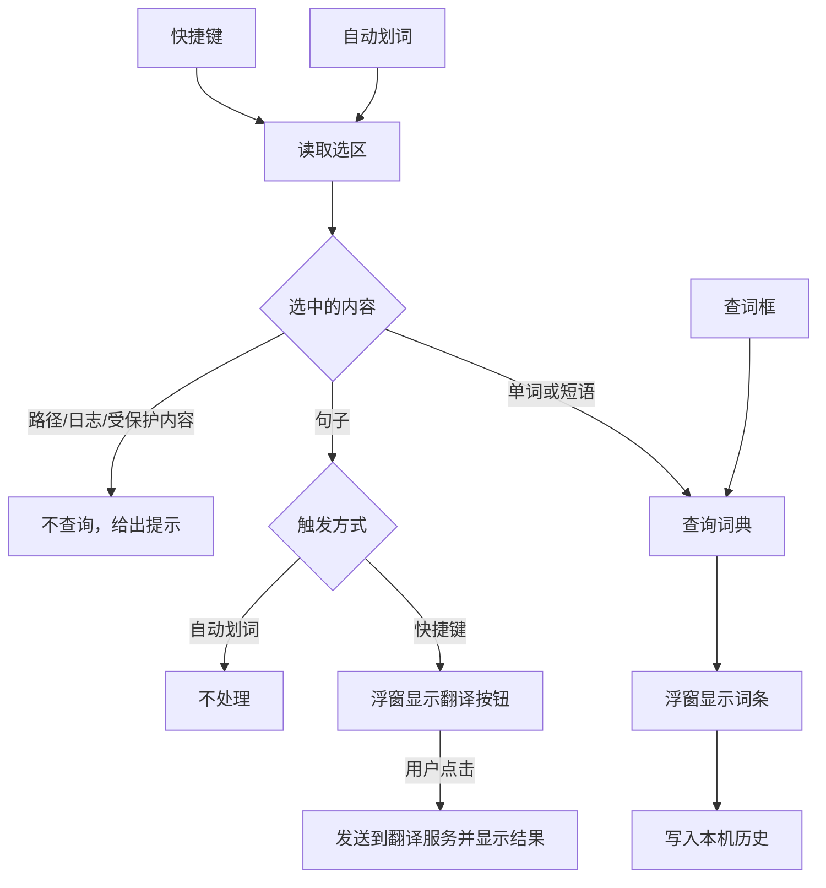

# WordSide 产品开发文档

| 项目 | 内容 |
|---|---|
| 基线 | `v0.2.0`（提交 `9da0577`） |
| 目标版本 | `0.3.0`：重新设计的新版 |
| 状态 | **暂停：** 等[市场调研](MARKET-RESEARCH.md)后确定差异化方向，再修订本文档 |
| 相关文档 | [架构（0.2.0）](ARCHITECTURE.md) · [开发指南](DEVELOPMENT.md) · [贡献约定](../CONTRIBUTING.md) · [发布流程](RELEASING.md) |

## 1. 方向决定

维护者已确认以下决定，改动需要维护者同意。

| 问题 | 决定 |
|---|---|
| 产品定位 | 阅读时快速查词，仍是安静、紧凑的工具 |
| 重构方式 | 新建结构后重写，不在旧结构上逐步修改 |
| 必须保留 | 读取单词 API 的逻辑（请求 Cambridge 和解析词条） |
| 技术栈 | 保持 Tauri 2、Rust、原生 TypeScript，不引入前端框架 |
| 取词层 | 拆分结构，判断逻辑和时序规则保持不变 |
| 新功能 | 查词历史、句子翻译 |
| 界面 | 浮窗和主窗口整体重新设计 |
| 平台 | 只做 Windows x64，平台代码隔离，便于以后扩展 |

**不做：** 账号、云同步、生词本和复习、离线词库、macOS / Linux。

## 2. 产品设计

### 2.1 主要流程



### 2.2 界面

| 界面 | 设计要点 |
|---|---|
| 主窗口 | 改成带导航的应用：**查词**、**历史**、**设置** |
| 查词页 | 查词框加结果区，词条展示和浮窗共用一套组件 |
| 历史页 | 按时间列出查过的词，可搜索、点击重查、删除单条或全部清空 |
| 设置页 | 取词、外观、翻译、隐私分组 |
| 浮窗 | 重新设计信息层次；不遮挡选中的单词；高度贴合内容；保留拖动、缩放和固定 |
| 外观 | 保留配色和浅色/深色/跟随系统这些能力，视觉样式重新设计 |

实现前先出设计稿（R1），维护者确认后才写界面代码。

### 2.3 功能需求

| 编号 | 需求 | 验收标准 |
|---|---|---|
| FR-01 | 自动划词 | 开关打开后，在支持的应用里选词即弹出浮窗；默认关闭 |
| FR-02 | 全局快捷键 | 默认 Ctrl+Alt+A；可修改、撤销、停用；保存和注册是一个事务 |
| FR-03 | 手动查词 | 输入词或短语后按 Enter 查询 |
| FR-04 | 输入清理 | 清理首尾符号；保留词内撇号和连字符；查词上限 80 字符、5 个词；由 `selection-cases.json` 约束 |
| FR-05 | 词条展示 | 释义、例句、音标、英/美发音、词性跳转、“原词典”链接，内容不比 0.2.0 少 |
| FR-06 | 缺词处理 | 英汉缺词回退英英；最终缺词显示拼写建议（最多 10 条），点击才查询 |
| FR-07 | 浮窗 | 可拖动、缩放；尺寸跨重启保留；固定后同窗更新；不遮挡选中的单词；空状态和错误状态高度贴合内容 |
| FR-08 | 外观 | 多套配色加浅色/深色/跟随系统；托盘和窗口图标跟随配色 |
| FR-09 | 托盘与窗口 | 关闭主窗口可选隐藏到托盘或退出；双击托盘打开；最小化后也能恢复；单实例 |
| FR-10 | 诊断 | `capture-status.json` 记录最近一次故障；保留 CLI 诊断入口 |
| FR-11 | 错误提示 | 拦截、网络失败、超时、缺词的提示互不相同，并给出下一步 |
| FR-12 | 查词历史 | 查询成功后写入本机；可搜索、重查、删除单条、全部清空、关闭记录 |
| FR-13 | 句子翻译 | 见 2.4 节 |

### 2.4 句子翻译的规则

1. **只由用户明确触发：** 快捷键读到句子后显示翻译按钮，点击才发送。自动划词永远不会发送句子。
2. **默认关闭：** 在设置里配置翻译服务后才可用。
3. **不内置密钥：** 公开发布的程序里无法保管密钥，由用户填写自己的密钥，存入 Windows 凭据管理器，不写入 `settings.json`。
4. **限制长度：** 单次上限 2000 字符，超过时提示，不静默截断。
5. **受保护内容：** 密码框等受保护区域和查词一样不读取。
6. **不写入历史：** 翻译内容默认不保存。

## 3. 非功能需求

| 类别 | 约束 |
|---|---|
| 隐私 | 查询词只发往 Cambridge；句子只在用户点击后发往用户配置的翻译服务；历史只存本机；诊断文件不超过 4 KiB，且不含单词、应用身份、剪贴板内容 |
| 词条缓存 | TTL 15 分钟、最多 32 条、总量 12 MiB；只在内存中，历史不保存完整词条 |
| 剪贴板 | 备份上限 64 MiB / 128 种格式；被动读取单次不超过 200 ms；用户期间新复制的内容优先于恢复 |
| 时序 | 40 ms 稳定释放门；750 ms 焦点等待上限；复制前重读等待 80 ms；残留按键状态 80 ms 后清除 |
| 安全 | CSP 只增加用户配置的翻译接口所需的最小范围，其余不放宽；`open_source` 只允许 `https://dictionary.cambridge.org` |
| 兼容 | 能读取 0.2.0 的 `settings.json`；不改应用标识 `local.wordside.dictionary.api-preview`，否则用户设置会丢失 |
| 体积 | 0.2.0 主程序约 11.9 MB，新版增长超过 10% 须说明原因 |
| 授权 | 保留 Nongfsq / EliasChen 署名和 MIT 许可；新增依赖要记入第三方许可 |
| 边界 | 不做任何绕过 Cloudflare 人机验证的手段，包括伪装指纹、自动完成验证、借用 WebView 的验证状态 |

## 4. 保留、迁移、重写

| 部分 | 现在的位置 | 处理 | 要求 |
|---|---|---|---|
| 读取单词 API | `dictionary.rs`、`dictionary/`、`lookup.rs` 及其测试和夹具 | **原样搬移** | 除路径和模块引用外不改；输出的 JSON 不变 |
| 上游对照模块 | `modules/cambridge-dictionary-api/` | 不动 | 继续用于校对解析行为 |
| 词条 JSON 校验 | `shared/dictionary.ts` | 改成 ES 模块 | 校验规则不变，现有测试全部保留 |
| 输入清理 | `selection_input.rs`、`selection-cases.json` | 搬移 | 用例不变 |
| 取词层 | `capture/` | **拆结构** | 判断逻辑和时序不变；现有测试全部迁移，数量不减 |
| 缓存 | `cache.rs` | 搬移 | ticket / settle 协议不变 |
| 设置 | `main.rs` | 重写 | 统一更新入口；兼容旧文件；原有设置测试全部保留 |
| 应用层 | `main.rs` 及窗口相关模块 | 重写 | `main.rs` 只做入口分派 |
| 界面 | `desktop/src/`、`index.html`、`style.css` | 重写 | ES 模块；以原生设置为唯一来源 |
| 前后端接口 | 13 个命令、6 个事件 | 重新设计 | 用契约测试固定；词条 JSON 不变 |

## 5. 目标架构

```text
apps/desktop/
├─ src-tauri/src/
│  ├─ main.rs             入口：只分派诊断模式、取词辅助进程和桌面模式
│  ├─ app/                状态、命令（薄层）、托盘、窗口事件、启动
│  ├─ settings/           模型（含旧字段兼容）、统一的更新事务
│  ├─ dictionary/         读取单词 API，原样搬移
│  ├─ lookup/             查询编排：缓存门控、取消、写历史
│  ├─ history/            本机历史存储（新增）
│  ├─ translation/        翻译接口和服务适配（新增）
│  ├─ window/             浮窗几何和位置、窗口边框、图标、关闭策略
│  └─ capture/
│     ├─ core/            无 Win32 依赖的判断逻辑
│     └─ windows/         hook、UIA、Edit、OLE、剪贴板、辅助进程
└─ src/
   ├─ main.ts             入口
   ├─ views/              查词、历史、设置、浮窗
   ├─ components/         词条、错误状态等共用组件
   └─ lib/                原生接口封装、词条校验、提示文案
```

**技术选择：**

| 问题 | 决定 | 理由 |
|---|---|---|
| 新旧代码如何并存 | 新代码放 `apps/desktop/`，旧的 `desktop/` 保持可发布，功能齐备后切换并删除 | 不需要长期分支，`main` 随时可发布 0.2.x 修复 |
| 前端模块 | `tsc` 输出 ES 模块，用 `<script type="module">` 加载 | 不增加依赖；测试可以直接导入模块 |
| 取消机制 | `tokio::sync::watch`，保留“世代”语义 | 去掉 30 ms 轮询 |
| 实机测试隔离 | 标记 `#[ignore]`，另设显式命令运行 | `cargo test` 默认安全，不再需要 16 个过滤器 |
| 历史存储 | SQLite（`rusqlite`） | 搜索和删除方便，见第 10 节 |

**要解决的旧问题：**

- `main.rs` 职责过多，设置更新流程重复 4 次。
- `State` 里 5 个计数器的递增散落各处，取消语义难以追踪。
- 前端是全局脚本，测试要靠 `vm` 和手写假 DOM；localStorage 和原生各存一份设置，默认值还不一致。
- 取词的判断逻辑和 `unsafe` Win32 调用混在一起。
- 取词测试没有安全的默认入口；9 个用例 CI 从未运行，其中 5 个没有标记 `#[ignore]`。
- 没有 clippy 检查；CI 单次 17–22 分钟，没有 Cargo 缓存；版本号散落在 6 个文件；发布全部手工。

## 6. 开发里程碑

每个里程碑拆成多条短期分支，分别走 PR 合入 `main`。

| 里程碑 | 内容 | 完成标准 |
|---|---|---|
| **R0 方向** | 确认本文档和第 10 节的产品决定 | 已确认（开源许可除外，不影响开工） |
| **R1 设计稿** | 浮窗、查词、历史、设置、翻译的可交互设计稿，用示例数据，不写业务逻辑 | 维护者确认设计 |
| **R2 新骨架** | 建 `apps/desktop/`；搬移读取单词 API、缓存、输入清理；重写设置和应用层；CI 同时检查新旧代码，加 clippy 和缓存 | 新程序能启动并手动查词（用夹具验证）；词典测试和夹具结果不变 |
| **R3 新界面** | 按设计稿实现主窗口和浮窗；契约测试固定前后端接口 | FR-03、05、06、08、09、11 通过；词条内容不比 0.2.0 少 |
| **R4 取词迁移** | 一次一个模块，按 `input` → `windows_text` → `windows` → `probe` → `windows_copy` 拆分；判断逻辑进 `core/` | 用例不少于 0.2.0；`core/` 无 Win32 依赖；每个 PR 附 7 节相关项的实测结果 |
| **R5 查词历史** | 存储、历史页、隐私开关，更新 PRIVACY | FR-12 通过；关闭记录后不再写入；清空后文件中无残留 |
| **R6 句子翻译** | 翻译接口、设置页、凭据存储，更新 PRIVACY | FR-13 通过；自动划词不发送任何句子；密钥不出现在设置文件和日志中 |
| **R7 切换发布** | 切换构建到新代码，删除 `desktop/`；更新全部文档；打标签触发的发布流程；发 0.3.0 预发布版试用，再转正式版 | 7 节实测完成，未测项写明原因，R-06、R-07 必测；从 0.2.0 升级后设置保留 |

**依赖：** R0 → R1 → R2 → R3 → R5、R6；R4 依赖 R2，可与 R3 同时进行；R7 最后。

**先合入：** 本地分支 `chore/rustfmt` 在 R2 开始前合入，之后搬移的代码才是统一格式。

## 7. 回归验收矩阵

这些都来自 CHANGELOG 里修过的真实问题，只能实机验证，不能用模拟代替。

| 编号 | 场景 | 预期 | 来源版本 |
|---|---|---|---|
| R-01 | 系统记事本、常见输入框选词 | 原生范围准确读取，不触发复制 | 0.1.2 |
| R-02 | Edge / Chrome 网页（如 GitHub）连续划词和快捷键 | 不误报“请重新选词” | 0.1.3、0.1.4 |
| R-03 | Zotero 等 PDF | 不读到相邻或偏移的文字 | 0.1.1 |
| R-04 | PowerShell 7 终端用 Alt+D | 选区不被清除，不激活菜单 | 0.1.2、0.1.3 |
| R-05 | Pebrel 终端 | 自动划词和快捷键都可用 | 0.1.4 |
| R-06 | 剪贴板里有资源管理器复制的文件时取词 | 可取词，之后仍能粘贴文件 | 0.2.0 |
| R-07 | 取词前后剪贴板内容（文本、位图、富文本） | 恢复；期间新复制的内容优先 | 0.1.1、0.1.2 |
| R-08 | 密码框和受保护区域 | 不读取、不复制 | 0.1.2 |
| R-09 | 长时间闲置、开机繁忙后 | 监听自动恢复，无需重启 | 0.1.4 |
| R-10 | 双击、拖选、关闭旧浮窗后再选 | 每次都触发，不重复启动 | 0.1.2、0.1.3 |
| R-11 | 查询 `minutes`、`runtime`、`term`、错拼词 | 短语词条有释义；错拼显示建议 | 0.1.3 |
| R-12 | 不同 DPI 和多显示器之间移动浮窗 | 尺寸和位置正确；图标清晰 | 0.1.0、0.2.0 |
| R-13 | 托盘：双击、右键、关闭到托盘后重建主窗口 | 符合 FR-09 | 0.1.0 |
| R-14 | 安装版、便携版；从 0.2.0 升级 | 正常运行，设置保留 | 0.1.0 |
| R-15 | 断网、取消查询、快速连续查词 | 分类提示；旧结果不覆盖新词 | 0.1.0 |
| R-16 | 自动划词选中整句 | 不向任何翻译服务发送内容 | 新增 |
| R-17 | 关闭历史或清空后 | 不再写入，已有记录被删除 | 新增 |

## 8. Git 版本管理

沿用 [CONTRIBUTING.md](../CONTRIBUTING.md) 和 [RELEASING.md](RELEASING.md)。

| 工作 | 分支 | 提交前缀 |
|---|---|---|
| 新版功能 | `feat/<范围>` | `feat:` |
| 代码搬移、结构调整 | `refactor/<范围>` | `refactor:` |
| 修复 | `fix/<范围>` | `fix:` |
| 工程 / 文档 / 测试 | `chore/…` / `docs/…` / `test/…` | `chore:` / `docs:` / `test:` |

**规则：**

1. 搬移和改动分开提交，读取单词 API 和取词层尤其如此，这样 diff 才审得动。
2. 取词层一个 PR 只动一个模块，并附实测结果。
3. 迁移过程中测试数量不减，PR 里写明前后的用例数。
4. 旧版需要紧急修复时，直接在 `desktop/` 修并发 `0.2.x`。
5. 任务分支不强推，已有标签不移动。
6. squash 合并后 Git 认不出分支已合并，先确认和 `main` 没有差异，再用 `git branch -D` 删除。

**版本：** 开发期间版本号不变，全部完成后发 `0.3.0`，先用 `--prerelease --latest=false` 试用。`v0.2.0` 是基线，不另打标签。成品放 GitHub Release，不进 Git。

## 9. 风险

| 风险 | 影响 | 对策 |
|---|---|---|
| 取词时序在拆分中被改变，自动测试发现不了 | 高 | 判断逻辑和时序常量不改；一次一个模块；每个 PR 附实测 |
| 破坏剪贴板恢复，影响用户数据 | 高 | `copy_policy` 的事务和测试原样保留；R-06、R-07 必测 |
| 新旧代码并存，修复要改两处 | 中 | 尽量缩短 R2 到 R7 的时间；并存期间只修严重问题 |
| 新界面丢失旧版细节（如发音合并、部分仅英文标记） | 中 | FR-05 按 0.2.0 逐项对照；用相同示例数据对比 |
| 历史保存查询词，改变了“退出后清空”的隐私承诺 | 中 | 更新 PRIVACY；升级后首次运行时说明；可关闭、可清空 |
| 句子翻译把用户选中的内容发给第三方 | 中 | 只由用户点击触发；默认关闭；界面明确显示发送目标 |
| Cambridge 访问策略变化 | 中 | 已在一个网络环境下遇到人机验证，影响范围待确认；不绕过，给出明确提示；用夹具把解析问题和网站问题分开 |
| 实机验证被跳过 | 中 | PR 如实填写未测项；R7 前集中验收 |

## 10. 产品决定

| 编号 | 事项 | 决定 | 影响 |
|---|---|---|---|
| D-1 | 翻译服务 | 先支持 OpenAI 兼容接口，用户自己填地址和密钥；以后可增加其他服务 | R6 |
| D-2 | 单次翻译长度上限 | 2000 字符，超过时提示 | R6 |
| D-3 | 查词历史默认状态 | 默认开启，首次运行时说明，可随时关闭 | R5、隐私说明 |
| D-4 | 历史保存内容 | 只存查询词、词条名、时间，不存释义；点击时重新查询 | R5 |
| D-5 | 历史存储 | SQLite（`rusqlite`），搜索和删除方便，体积会增加，实现时记录实际增量 | R5 |
| D-6 | 自有代码的开源许可 | **待维护者决定**，0.3.0 前定下来 | R7 |

## 11. 0.2.0 基线

| 检查 | 结果 |
|---|---|
| 远端 CI（`main` @ `9da0577`，运行 `39291291018`） | 通过，耗时 21 分 49 秒 |
| 本地 `npm test` / `npm run check` / `npm run build` | 通过，`npm test` 66 个 |
| 本地 `windows-cargo.ps1 -Action test` 及 16 个过滤器 | 226 个用例中，通过 215 个，跳过 2 个，9 个未运行 |
| 实机验收矩阵 | 部分完成，其余在其他电脑上继续测 |
