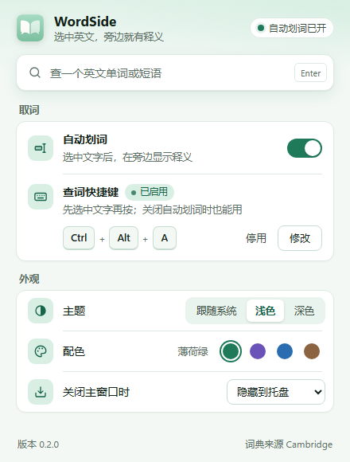
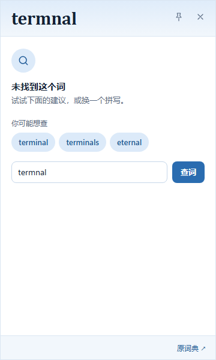

# WordSide · 词伴使用指南

选中英文，查看释义，然后继续阅读。

[下载 0.1.0](https://github.com/caoshuo2003/wordside/releases/tag/v0.1.0) · [常见问题](FAQ.md) · [隐私与数据](PRIVACY.md) · [返回首页](../README.md)

## 安装与第一次查词

WordSide 0.1.0 为 **Windows x64 预发布版**，需要 Microsoft Edge WebView2 和可访问 Cambridge 的网络。取词兼容与安装问题见[常见问题](FAQ.md)。

| 方式 | 操作 |
|---|---|
| 安装版 · 推荐 | 下载 `WordSide_0.1.0_x64-setup.exe`，按提示安装，打开 WordSide |
| 便携版 | 下载 `WordSide_0.1.0-portable.zip`，解压全部文件，运行其中的程序 |
| 单独 EXE | 下载并运行 `WordSide_0.1.0.exe`；同一发布页提供第三方许可文件 |

打开后，在“手动查词”输入英文单词或短语，点击“查询”，即可查看词条。

若旧版还在运行，先在托盘右键选择“退出 WordSide”，再打开新版。应用设置底部可以查看版本。

## 选择查词方式

| 方式 | 怎么用 |
|---|---|
| 自动划词 | 打开“自动划词”，在其他应用选中英文单词；读到选区后弹出释义 |
| 快捷键 | 选中单词后按 **Ctrl+Alt+A**；关闭自动划词后也可以使用 |
| 手动输入 | 在 WordSide 中输入英文单词或短语，点击“查询” |

要修改快捷键，点击“录入按键”，按下想用的组合，再点击“保存”。已有设置会在升级后保留；新安装的默认快捷键为 **Ctrl+Alt+A**。

有些应用或文本区域无法读取选区，遇到这种情况可以手动输入查询。在 Windows 桌面终端中使用时，选中要查的单词即可；尽量选取单词本身，避免带上整条命令或文件路径。

## 阅读释义与播放发音

浮窗展示释义、例句、词性和音标。点击发音旁的播放按钮，可以听英式或美式发音；点击“展开全部例句”，可以查看收起的例句。内容较长时，在浮窗中滚动阅读。

部分词条只有英文解释，会标记为“英文释义”；只有一部分缺少中文时，显示“部分仅英文”。英汉词库没有该词时，WordSide 会尝试英英词库。

如果词典给出的词条与查询词不同，界面会显示“查询词 → 词条”，方便核对。想继续阅读词典原页，点击浮窗底部的“原词典”。

## 移动、调整与固定浮窗

| 操作 | 效果 |
|---|---|
| 拖动顶部 CAMBRIDGE 一带的空白区域 | 移动浮窗 |
| 拖动四边或四角 | 调整大小，尺寸会自动记住 |
| 点击“固定” | 保持浮窗可见；后续查词在同一窗口更新，保留位置和大小 |
| 点击浮窗的关闭按钮 | 收起当前释义 |

固定后仍可移动、缩放。想让发音并排显示，可以把浮窗稍微拉宽。窗口大小会在重启后保留；重新打开应用时，浮窗恢复未固定状态。解除固定或收起后，下一次查词会重新跟随取词位置。

## 选词不完整或没查到

`“runtime,”`、`<terminal>=` 这类首尾符号会自动清理。单词内部的撇号和连字符会保留，例如 `don't`、`run-time`。

多选或少选字母时，若词典提供拼写建议，浮窗会显示“你可能想查”。点击其中一个候选继续查询，也可以回到输入框修改单词。

如果选中的片段本身就是有效单词，例如 `term`，会直接显示这个词的释义。希望查询更长的词时，请重新选中完整单词。

连接失败时，可以稍后再查一次；具体排查办法见[网络与速度](FAQ.md#网络与速度)。

## 主题与配色

在“外观”中选择 **日间 / 夜间 / 跟随系统**，在“配色”中选择 **薄荷绿 / 雾紫 / 浅蓝 / 暖灰**。设置会自动保存。

## 托盘与退出

在“关闭主窗口时”选择：

- **隐藏到托盘**：收起主窗口，继续使用划词；双击托盘图标重新打开。
- **退出 WordSide**：关闭主窗口时结束程序。

托盘右键菜单可以切换自动划词、打开 WordSide 或退出。释义浮窗的关闭按钮只收起当前释义。

## 网络、本地设置与卸载

查词直接访问 Cambridge Dictionary，播放发音时从该网站获取音频。需要代理时可使用 Windows 系统代理，配置方法见[网络与速度](FAQ.md#网络与速度)。

窗口大小、快捷键和配色保存在本机。便携版可以解压运行，设置仍保存在 Windows 应用配置目录；复制程序到另一台电脑时，需要重新设置。详见[隐私与本地数据](PRIVACY.md)。

安装版可从 Windows“已安装的应用”卸载。便携版先退出 WordSide，再删除解压目录。若希望同时清除个人设置，请参考[重置设置](PRIVACY.md#重置设置)。

*文档图片使用示例词条，说明见[界面图片](SCREENSHOTS.md)。*
